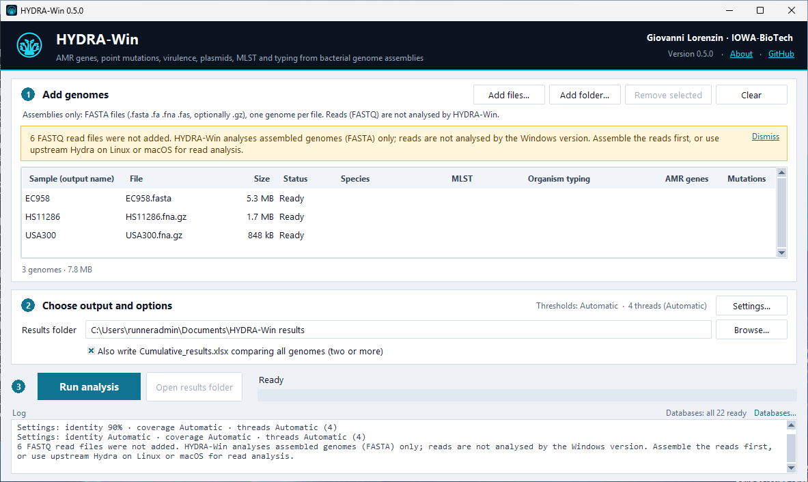
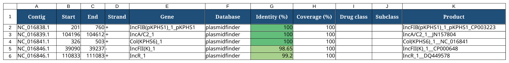
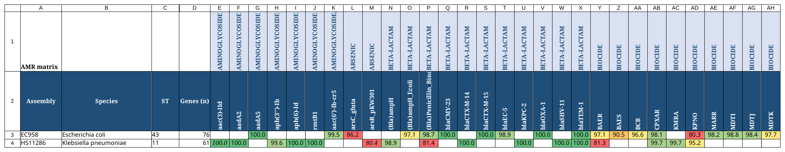
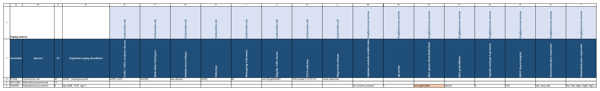

<p align="center"></p>

<h1 align="center">HYDRA-Win</h1>

<p align="center"><b>Giovanni Lorenzin · IOWA-BioTech</b></p>

<p align="center">
  <a href="https://github.com/iowa69/HYDRA-Win/releases/latest/download/HYDRA-Win-windows-x64.zip">
    
  </a>
  <br>
  <sub>One zip, about 78 MB. Unzip, double-click <code>HYDRA-Win.exe</code>. No install.</sub>
</p>

A portable Windows app for the bacterial genome analyser
[Hydra](https://github.com/iowa69/hydra). Give it genome assemblies (FASTA; reads
aren't analysed, see [Assemblies only](#assemblies-only)) and it reports
acquired AMR genes, resistance point mutations, virulence factors, plasmid replicons,
MLST, lineage and serotype typing, and resistance/virulence scores, in one Excel
workbook per genome.

You don't install anything. There's no conda, no admin rights and no console window.

## Screenshots

The window is shown as the release workflow captured it on Windows, on a 1366×768
screen, while it drove the real app through an analysis of three public genomes,
*K. pneumoniae* HS11286, *E. coli* EC958 and *S. aureus* USA300 FPR3757. The report
views are workbooks from a run on those same three assemblies.

**1. Add genomes.** The window opens with three steps: add genomes, choose output and
options, run. It says up front that it analyses assemblies only.

<p align="center"></p>

**Genomes loaded.** One row per genome. *Sample* is the name its results folder and
workbook will get.

<p align="center"></p>

**2. Settings.** Minimum % identity, minimum % coverage and threads, each Automatic
unless you enter a value (see [Settings](#settings)).

<p align="center"></p>

**FASTQ files are not added.** Dropping a folder of reads gives one notice with the
count.

<p align="center"></p>

**3. Run.** Each row shows its status live.

<p align="center"></p>

**Finished.** Species, MLST, the headline organism typing, AMR genes and point
mutations fill in as each genome finishes, and the log lists each mutation with the
resistance it is associated with. A species no organism module covers says so rather
than leaving the cell blank. Double-click a row to open its workbook.

<p align="center"></p>

**Databases.** Click **Databases…** under the window: every database, whether it
ships in the zip or is downloaded on this PC, and, for one that is missing, the real
reason the download failed, with **Retry download** and **Import from folder…** (see
[When a download fails](#when-a-download-fails)).

<p align="center"></p>

**Pivot sheet:** every locus against every database, shaded by % identity, with its location.

<p align="center"></p>

**Summary sheet:** species, MLST, scores, the organism typing headline and every typing
call, counts for one genome, and each point mutation or gene disruption in one plain
sentence.

<p align="center"></p>

**AMR_genes sheet:** the raw hits, each with contig, start, end and strand.

<p align="center"></p>

**Point_mutations sheet:** what mutated, read from the assembly, and what it means
(see [Point mutations and gene disruptions](#point-mutations-and-gene-disruptions)).

<p align="center"></p>

**Plasmids sheet**

<p align="center"></p>

**Typing sheet:** every typing call for one genome — here *S. aureus* USA300 FPR3757 —
with the evidence the call rests on and its caveats on the same row. spa `t008`, *agr*
group I, PVL positive, capsule serotype 5, immune evasion cluster type B, and *hlb*
reported as interrupted by a Sa3int prophage with the 43 kb alignment gap that shows it
(see [Organism-specific typing](#organism-specific-typing)).

<p align="center"></p>

**Cumulative_results, Summary:** one row per assembly, with its headline organism
typing.

<p align="center"></p>

**Cumulative_results, AMR matrix:** assemblies against genes, grouped by drug class.

<p align="center"></p>

**Cumulative_results, Mutations matrix:** assemblies against genes; each cell states
the change the assembly carries, with the resistance above each gene.

<p align="center"></p>

**Cumulative_results, Typing matrix:** assemblies against typing schemes, the organism
above each column and the headline calls in column D — a whole batch compared at a
glance.

<p align="center"></p>

## Get started

1. Click the green **Download** button above (or get `HYDRA-Win-windows-x64.zip` from
   [Releases](https://github.com/iowa69/HYDRA-Win/releases)).
2. Unzip it into a folder you can write to, for example *Downloads* or *Desktop*
   (not *Program Files*).
3. Double-click `HYDRA-Win.exe`.

Thirteen of the fourteen gene and typing databases, and the organism typing data for
all eight organisms, are in the zip — including the PubMLST MLST schemes, so **MLST and
everything derived from a sequence type work with no internet at all**. The first time
it starts, HYDRA-Win downloads only what it isn't allowed to redistribute: CARD, the
Ridom *spa* database, hicap's *cap* database and ShigEiFinder's gene sets (see
[Databases](#databases)). This needs an internet connection and takes a few minutes. It
only happens once. Everything else works without them, and every workbook says what
was not done (see [When a download fails](#when-a-download-fails)).

**Using it:**

1. **Add genomes.** Drag FASTA files or folders onto the window, or click
   **Add files…** or **Add folder…** (folders are searched recursively). Each genome
   gets a row. Its *Sample* name comes from the file name, and its results go to
   `<results>\<sample>\<sample>.xlsx`. When two files have the same name, the second
   becomes `<name>_2`, the third `<name>_3`, and so on. Those rows are highlighted, so
   no result is overwritten.
2. **Choose output and options.** Pick a results folder. Tick
   **Cumulative_results.xlsx** if you want an extra workbook comparing all the genomes.
   **Settings…** changes the thresholds and threads (all Automatic by default).
3. **Run analysis.** Genomes are analysed one after another. Each row goes from
   *Queued* to *Running* to *Done*, and then shows the species, MLST, number of AMR
   genes and number of point mutations. A genome that fails is marked *Failed* (the log
   says why) and the others still run. Double-click a finished row to open its
   workbook, or click **Open results folder**.

The header's **About** link shows the version, credits and licences.

### Assemblies only

HYDRA-Win analyses **assembled genomes**: one FASTA file per genome (`.fasta`, `.fa`,
`.fna` or `.fas`, each optionally gzipped). It does **not** analyse reads.

If you drop or select FASTQ files (`.fastq` or `.fq`, compressed or not), HYDRA-Win
doesn't add them, and one notice says how many were left out. Their names don't matter:
a FASTQ file is never matched to an assembly or used in any way, whether or not it
shares the assembly's name. To analyse reads, assemble them first (for example with
SPAdes or Shovill) and add the assemblies, or use upstream
[Hydra](https://github.com/iowa69/hydra) on Linux or macOS, which has a reads mode.

### Settings

Click **Settings…**. Every setting is **Automatic** unless you untick it and enter a
value.

| Setting | Automatic | A value you enter |
| --- | --- | --- |
| Minimum % identity | Upstream Hydra's defaults: 80% for the nucleotide databases, except PlasmidFinder (95%) and EcOH (90%), which have stricter defaults of their own | Applies to every nucleotide database and replaces those defaults, exactly like upstream's `--min-identity` |
| Minimum % coverage | 60% of the reference gene, except EcOH (80%) | Applies to every nucleotide database, like upstream's `--min-coverage` |
| Threads | All CPU cores | Changes speed only, never results |

The two thresholds filter the nucleotide searches: NCBI, CARD, ResFinder, ARG-ANNOT,
MEGARes, VFDB, *E. coli* VF, PlasmidFinder and EcOH. As in upstream, the AMRFinderPlus
protein search keeps its own 90% identity / 90% coverage, and point mutations and
MLST/typing keep their own rules. Values go from 0 to 100, with decimals allowed
(`92.5` or `92,5`).

Every workbook's `Summary` sheet records the settings used in a *Settings used*
section, together with the equivalent upstream flags. `Cumulative_results.xlsx`
records them under its summary table. Any result can be traced to its thresholds.

### Headless mode

```
HYDRA-Win.exe --cli genome1.fasta genome2.fna.gz --out C:\results --cumulative
HYDRA-Win.exe --cli C:\assemblies --out C:\results --min-identity 90 --min-coverage 80
```

This runs the same code path as the window. Other options:

| Option | What it does |
| --- | --- |
| `--min-identity PCT` | Minimum % identity (default: Automatic, as above) |
| `--min-coverage PCT` | Minimum % coverage (default: Automatic, as above) |
| `--threads N` | Number of threads to use (default: all cores) |
| `--offline` | Don't download missing databases |
| `--log FILE` | Also write the log to `FILE` |
| `--db-status` | Report which databases are installed, and why a missing one failed |
| `--fetch-db` | Download the first-launch databases, then exit |
| `--import-db FOLDER` | Install the first-launch databases, organism typing data included, from a folder copied from another PC, then exit |
| `--version` | Print the version |

FASTQ inputs are skipped with one warning. The exit code is non-zero if any genome
failed. Every run also writes `hydra-win.log` into the results folder.

### When a download fails

Six things are downloaded on first launch: PubMLST, CARD, the Ridom *spa* database,
hicap's *cap* database, ShigEiFinder and the *N. meningitidis* typing data. For
PubMLST and CARD, HYDRA-Win uses the Windows network settings, as your browser does:
the system proxy (including automatic proxy configuration scripts), the Windows
certificate store (so a hospital network that inspects HTTPS works), and, if Python's
own connection is refused, Windows' own downloader with your logon credentials (for
proxies that ask for them). Each download is retried, and the reason for a failure (an
HTTP status, an untrusted certificate, a timeout, a proxy refusal, a name that does not
resolve) is written to the log and shown under **Databases…**.

The organism typing modules fetch their own data with Python's standard downloader.
That uses the Windows certificate store and the proxy Windows reports for the process,
but not the PowerShell fallbacks above. On a network where those fetches fail, the
import route below installs them as well.

If this PC still cannot reach the servers:

1. On a PC where HYDRA-Win downloaded them (same or newer version), copy its `db`
   folder (next to `HYDRA-Win.exe`, or `%LOCALAPPDATA%\Hydra-win\db`) to a USB stick.
2. On this PC, open **Databases…** → **Import from folder…** and choose that folder
   (or the whole HYDRA-Win folder), or run `HYDRA-Win.exe --import-db E:\db`.

Importing a folder installs the organism typing data too, not only CARD.

Without them, analyses still run with the thirteen bundled databases and the bundled
organism typing data — which now includes MLST, so a sequence type is assigned either
way. The window, the log and every `Summary` sheet state what was not done, for example
*CARD not screened: genes only CARD lists were not looked for*, and an organism call
whose database is missing reads *not determined* with the reason on the same row of the
`Typing` sheet rather than staying empty.

### Upgrading

Unzip the new version into its own folder. Databases an earlier version downloaded
into `%LOCALAPPDATA%\Hydra-win` are reused; otherwise the first-launch downloads run
again, or can be imported from the old folder with **Import from folder…**.

## Output

For each genome, `<results>\<genome>\<genome>.xlsx` contains these sheets:

| Sheet | Contents |
| --- | --- |
| `Summary` | Any analysis not performed because a database is missing (first, highlighted), species, MLST scheme/ST/profile, scores (resistance 0-3, ESBL, carbapenemase, colistin, virulence), counts per category, detected genes per category, each point mutation and disruption in one sentence with its resistance, lineage/serotype typing, assembly QC, the settings used, and database versions and thresholds |
| `AMR_genes` | Every acquired AMR hit and every stress hit (biocide/metal/heat) |
| `Point_mutations` | Resistance point mutations and gene disruptions: what changed, where and what it means first, then the raw hit columns (see below) |
| `Virulence` | Virulence factor hits |
| `Plasmids` | Plasmid replicon hits |
| `Typing` | Every typing call for this genome: the species, MLST, the organism-specific schemes grouped by organism, the lineage/element schemes and the serotype loci. Each row carries **the evidence the call rests on** (alleles, residues, identity and coverage, contig coordinates, database version) and **its caveats** (what is provisional, what disagreed, what could not be determined). See [Organism-specific typing](#organism-specific-typing) |
| `All_hits` | Every hit in every category; mutation calls carry a one-line *Mutation: what changed* |
| `Pivot` | One row per locus, grouped by category and drug class, with one column per database. Each cell holds that database's % identity and is colour-coded; for a mutation it holds the change itself (`S83I`, `G134AfsTer11`) |

Every hit row has the contig, start, end and strand, plus gene, database, % identity,
% coverage, drug class/subclass, product, accession, element type, method, resolution
and note.

When several databases find the same locus, upstream Hydra marks one call as primary.
The other calls stay in the sheets in grey, with `Primary call = no`. They aren't
counted.

Colours: green for 100% identity, then light green, yellow, orange and red as identity
falls. Point mutations are blue, gene disruptions orange, and a gene cut by a contig
end grey. Italic means partial coverage.

### Point mutations and gene disruptions

Every call in `Point_mutations` states, without decoding:

| Column | Example (HS11286 *gyrA*) | Example (HS11286 *ompK35*) |
| --- | --- | --- |
| Mutation (AMRFinderPlus name) | `gyrA_S83I` | `ompK35_G134AfsTer11` |
| Type of call | Amino-acid substitution | Gene disruption: frameshift |
| Protein change / HGVS | `S83I` / `p.Ser83Ile` | `G134AfsTer11` / `p.Gly134AlafsTer12` |
| Nucleotide change | `c.248G>T (inferred)` | `c.401delG (inferred)` |
| Isolate codon / base (read from the assembly) | `ATC` | new frame from codon 134 stops at `TGA` (NC_016845.1:1904952-1904954) |
| Reference codon (INFERRED by parsimony) | `AGC` | |
| Base changed | G>T at codon position 2 | net 1-bp deletion |
| Mutation position on contig | NC_016845.1:3738482-3738484 (-) | NC_016845.1:1904986-1904990 (-) |
| Intact reference | | residues 1-133 of 359 (37%) |
| Resistance it is associated with | quinolone resistance | carbapenem resistance; loss of function |
| Kleborate-style call | `GyrA:p.Ser83Ile` | `OmpK35:p.Trp133fs` |

followed by *What it means* (one sentence), *Basis of the base change* and *Not
resolved*, then the raw hit columns.

* **The isolate's codon is read from the assembly**: the alignment is walked to the
  mutated residue, so the strand, indels before the position and contig ends are
  handled, and the codon is re-translated as a check.
* **Where the reference base comes from.** For the DNA loci of the AMRFinderPlus
  catalogue (rRNA, promoters) it is read from the catalogue's reference sequence.
  AMRFinderPlus ships proteins, not coding sequences, for the point-mutation genes, so
  for a protein mutation (and the codon behind a premature stop or frameshift) the
  reference codon is the codon for the reference amino acid closest to the isolate's
  codon. That is an inference: it has its own column, the nucleotide change is marked
  *(inferred)*, and when two codons are equally close nothing is claimed.
* **Gene disruptions are named by their lesion**, the way AMRFinderPlus names them
  (`ompK35_G134AfsTer11`, `mgrB_Q30Ter`): premature stop (codon and base change),
  frameshift (the net indel, where the new frame stops, the HGVS `fsTer`, and the
  deleted or inserted base when only one change restores the protein, marked
  *inferred*), interruption by inserted sequence (its size; the element itself is not
  identified), start codon lost, or 5' part absent. AMRFinderPlus counts the novel
  residues before the stop (`fsTer11`); HGVS counts the stop as well (`fsTer12`).
* **A gene cut by a contig edge is reported, and the row says so.** The call is never
  suppressed — a gene running off the end of a contig is a real finding, and hiding it
  would hide the gene behind an assembly artefact. But it is not a confirmed loss of
  function, and no part of the row lets it pass for one:

  | Where | What it says |
  | --- | --- |
  | *Type of call* | **Gene cut by a contig end: NOT evidence of disruption, loss of function not assessed** |
  | *Element subtype* | `DISRUPTION_AT_CONTIG_END` |
  | *Resolution* | `CONTIG_END` |
  | *Note* | leads with "runs off the end of contig …, so the gene is cut by the assembly: this is NOT evidence of disruption and loss of function could not be assessed. Reported rather than suppressed, but it is not a confirmed loss-of-function call" |
  | *Resistance it is associated with* | "loss of function not established: the gene is cut by a contig end" — and what a confirmed one *would* have meant |
  | matrix and pivot cells | `cut by contig end - not assessed`, struck through and greyed |

  The resistance score ignores such a row too: the row is reported in full, but a
  lesion that could not be assessed is not counted as resistance that is present.
  AMRFinderPlus reports the same situation as `PARTIAL_CONTIG_END`.
* **Kleborate's name** is given for the *K. pneumoniae* loci Kleborate types (GyrA,
  ParC, OmpK35, OmpK36, MgrB, PmrB).
* Anything that cannot be resolved to a codon (a position in an alignment gap, a codon
  past a contig end, a mosaic allele) says so in *Not resolved*.

### Organism-specific typing

Once the species is known, HYDRA-Win applies the typing a clinical or public-health
laboratory actually reports for that organism. Nothing has to be chosen: the species
call selects the schemes, and the MLST scheme selects them when there is no species
call.

| Organism | What is typed | Works with no internet |
| --- | --- | --- |
| *Staphylococcus aureus* | spa type (Ridom), *agr* group, MLST clonal complex, SCCmec, Panton-Valentine leucocidin, *tst*, enterotoxin and haemolysin repertoires, *hlb* status (and the Sa3int prophage that interrupts it), capsule serotype locus, immune evasion cluster type, ACME, *blaZ* operon | everything **except the spa type**, which needs the Ridom download |
| *Streptococcus pyogenes* | emm type and emm cluster with its tissue tropism, virulence and superantigen repertoire, prophage content, regulatory loci, adhesins | everything |
| *Streptococcus agalactiae* | capsular serotype, alpha-like protein (Alp) type, surface proteins, pilus island type, marker genes, PBP2X substitutions | everything |
| *Streptococcus pneumoniae* | capsular serotype, PBP type (1A:2B:2X) with the CDC reference MIC where that triplet is in the reference table, macrolide/lincosamide/tetracycline/fluoroquinolone determinants, pilus islets | everything |
| *Haemophilus influenzae* | capsule type (*cap* locus), PBP3 (*ftsI*) substitution pattern and rPBP3 group, β-lactam interpretation, MLST | everything **except the capsule type**, which needs the first-launch download of hicap's GPL-3.0 *cap* database |
| *Neisseria meningitidis* | capsule serogroup (with the lesion, where the locus carries one), fine type, Bexsero antigen sequence type (BAST) and MenDeVAR index, MLST and clonal complex, resistance target alleles | **everything**: all of its data is PubMLST nomenclature, and the pre-2025 snapshot is now in the zip |
| *Salmonella enterica* | serovar from the antigenic formula, subspecies, H2 (*fljB*) locus, pathogenicity islands, virulence plasmid, typhoidal markers, ST and eBurst group | everything |
| *Escherichia coli* and *Shigella* | phylogroup (Clermont), *fimH* allele, ST131 subclone, Shiga toxin subtype, pathotype, intimin (*eae*) subtype, ExPEC/UPEC virulence panel | everything **except the *Shigella*/EIEC cluster call** |

Each call is reported with the evidence it rests on and with its caveats, on its own row
of the `Typing` sheet. For example, *S. aureus* USA300 FPR3757:

| Scheme | Call | Evidence | Caveats |
| --- | --- | --- | --- |
| spa type (Ridom) | `t008` | `repeat_succession = 11-19-12-21-17-34-24-34-22-25`, `repeats = 10`, `region = NC_007793.1:128391-128785 (395 bp)` | spa types are tandem arrays and short-read assemblies lose repeats in about 1-15% of isolates depending on the assembler (Mollerup 2022), so confirm before acting on a single-repeat difference |
| β-haemolysin (*hlb*) status | `disrupted by prophage integration` | `hlb = 100.0% identity over 1-993/993`, `alignments = 2`, `contig_gap_bp = 43036` | the two alignment pieces are 43 kb apart with the break at base 183 of 993: the signature of a β-haemolysin-converting (Sa3int) prophage inside *hlb*. β-haemolysin is therefore not produced, despite *hlb* being 100% covered |
| MLST clonal complex | `CC8` | `ST = 8`, `profile = 3-3-1-1-4-4-3`, `nearest_founders = CC8 (7/7), CC239 (6/7), CC9 (4/7)` | ST8 is the founder of CC8 (7/7 loci shared) |

The headline calls (`spa t008 · CC8 · agr I`) are in the **Organism typing** column of
the window's table, in the title of the `Typing` sheet, in the genome `Summary` sheet
and in the cumulative `Summary` and `Typing_matrix` sheets.

**The honest limits**

* **"Not determined" is never a negative result.** Every undetermined call says why: a
  database that is not installed, a locus that reaches a contig end, a profile that is
  incomplete, an allele newer than the data. Undetermined calls are coloured in the
  `Typing` sheet so they cannot be skimmed past.
* **A capsule call states the type first and the lesion with it.** A meningococcus that
  carries a serogroup B locus it cannot express reads `B (capsule gene disrupted)`, not
  a bare `NG` with the genogroup hidden in another column — the laboratory's
  non-groupable result and the genome's genogroup are both true and belong together, and
  these lesions revert. The gene-by-gene evidence and the caveat are in the same row:
  which gene, what is wrong with it, that the laboratory will report non-groupable, and
  that an insertion-sequence or slipped-strand switch can turn the capsule back on. A
  capsule gene cut by a contig end is a third, distinct wording —
  `B (capsule gene at a contig end, expression not assessed)` — because an assembly
  boundary is neither an intact capsule nor a lesion. The same shape is used for
  *H. influenzae*: a single-copy *cap* locus with *bexA* truncated reads
  `b (capsule gene disrupted)`, while the normal virulent Hib arrangement (a duplicated
  locus with one *bexA* truncated) stays plain `b`.
* **Everything is read from the assembly.** A scheme that needs reads is not attempted.
  Repeat arrays (*spa*) and long loci (*cap*, *cps*, SCCmec) can be collapsed or split
  by a short-read assembler, which the caveats say for each affected call.
* **A locus that is present is not a locus that is expressed.** USA300 carries an intact
  *cap5* locus and does not make capsule; the caveat says so.
* **Where a call depends on the ST, it says so.** The *E. coli* ST131 subclone label
  (H30) is only meaningful if the Achtman ST is 131, which the row states.
* **PubMLST data is fetched anonymously and no API key is ever used.** Anonymous access
  returns only data submitted on or before 31 December 2024, which PubMLST's terms allow
  to be redistributed — which is what lets the snapshot ship in the zip and MLST work
  offline. A sequence type assigned after that date therefore reads *not determined*,
  with that reason, instead of being guessed. See
  [PubMLST: why the MLST schemes are now in the zip](#pubmlst-why-the-mlst-schemes-are-now-in-the-zip).
* **Serogroups W and Y are told apart on the sequence, not on a threshold.** They differ
  by one gene and those two genes (*csw*, *csy*) are 99% identical, so both clear any
  identity cut-off a protein search can set. The call goes to whichever serogroup's own
  gene the isolate matches better, the two scores are in the row's evidence, and when
  they are too close to separate the row says so and asks for serology or a
  serogroup-specific PCR.
* **No MIC is predicted unless a reference laboratory published the value.** The
  pneumococcal PBP type gives the CDC reference MIC only for a 1A:2B:2X triplet that is
  in the CDC table, and declines otherwise. The nearest-neighbour mode-MIC model was
  looked up and deliberately not built: in its own validation it gave very major error
  rates above 50% for three of six β-lactams, meaning resistant isolates called
  susceptible.
* **Marker rules are screens, not diagnoses.** An ExPEC or UPEC genotype says what the
  isolate could do, not where it was grown or what it caused.
* **Group C/G streptococci are not group A.** The CDC emm database also holds the
  `stG`/`stC`/`stL` types of *S. dysgalactiae*. A *S. dysgalactiae* isolate is not put
  through the *S. pyogenes* module, and if one of those records is the best match in a
  genome called as *S. pyogenes*, the heading says *S. dysgalactiae* rather than "emm
  type" so it cannot be read as a group A type.
* Full method, thresholds, provenance, validation tables and bibliography for every
  scheme are in upstream Hydra's
  [`docs/typing/`](https://github.com/iowa69/hydra/tree/typing-integration/docs/typing).

With **Cumulative_results** (and two or more genomes), `<results>\Cumulative_results.xlsx`
contains:

| Sheet | Contents |
| --- | --- |
| `Summary` | One row per assembly: the headline organism typing, every typing call, each mutation and its resistance |
| `AMR_matrix` | Assembly × gene matrix of primary calls, colour-coded by identity, with the drug class above each gene |
| `Mutations_matrix` | Assembly × gene; each cell states the change(s) the assembly carries (`S83L; D87N`, `G134AfsTer11`), with the resistance above each gene |
| `Virulence_matrix` | Same layout, for virulence genes |
| `Plasmids_matrix` | Same layout, for plasmid replicons |
| `Typing_matrix` | Assembly × typing scheme, with the call in each cell and the organism above each column. The headline calls are in column D. A call that could not be made is coloured instead of left blank, and its caveat is the cell's comment |
| `All_hits` | Every hit, with an `Assembly` column |

## What is (and isn't) included

HYDRA-Win runs upstream Hydra's own analysis code. It uses a pinned copy of
`hydra_amr` from [iowa69/hydra](https://github.com/iowa69/hydra) at commit `75ecbe8`
(branch `typing-integration`, open as pull requests #2 and #3), with two small,
documented Windows patches (see `src/hydra_amr/VENDORED.txt`). With Automatic settings,
the calls match upstream's `--preset deep`:

* every installed gene database
* AMRFinderPlus translated search with `--plus` elements
* point mutations
* MLST
* lineage and element typing
* organism-specific typing for the species found
* scores

Two pieces are added for Windows:

* **Species identification.** Upstream uses Mash, which has no Windows build.
  HYDRA-Win includes a pure-Python re-implementation of `mash dist` and runs it against
  Kleborate's species sketches. It gives the same shared-hash counts as Mash 2.3 on the
  test genomes. Upstream's species rules are then applied unchanged. Without it,
  upstream's MLST-only fallback names some *Klebsiella* genomes as *E. coli*.
* **BLAST+ path handling.** BLAST+ on Windows can't cope with spaces or non-ASCII
  characters in paths. HYDRA-Win runs it from an ASCII, space-free folder (the 8.3
  short name, or `%LOCALAPPDATA%\Hydra-win`) and passes it relative paths, so the app
  works from folders like `C:\Users\Jörg Müller\Downloads`. Its databases are built in
  BLAST's version-4 format, which has no LMDB index; on Windows each LMDB file takes up
  its full gigabyte-sized map.

**Limitations**

* **Reads aren't supported** (see [Assemblies only](#assemblies-only)). There's no
  FASTQ input and no heteroresistance or allele-fraction analysis. Upstream's read mode needs minimap2, samtools and pysam,
  and none of them runs natively on Windows. Use upstream Hydra on Linux or macOS for
  reads.
* **`vfdb_full` isn't used.** Upstream can't download it automatically, it overlaps
  with the core VFDB set, and it's by far the slowest search.
* The species sketches cover Enterobacterales. Other genera are named from their MLST
  scheme, as in upstream — which means that **until the first-launch download has run,
  only an Enterobacterales is identified to species**, and organism typing, which is
  selected from the species call or the MLST scheme, is not applied to anything else.
  After the download, every organism in the table above is identified and typed. The
  window and the workbook say "no module for this species" rather than leaving it
  blank.
* PubMLST and CARD need an internet connection on the first launch, or a copy
  imported from another PC. So do the *spa* type, the *H. influenzae* capsule, the
  *Shigella*/EIEC cluster call and the whole *N. meningitidis* module (see
  [Organism typing data](#organism-typing-data)). Everything else types offline.
* Organism-specific typing covers the eight organisms in
  [Organism-specific typing](#organism-specific-typing). Another species gets the
  species call, MLST, the lineage and element schemes and the full gene, mutation,
  virulence and plasmid analysis, and the **Organism typing** column says "no module for
  this species" rather than leaving a blank that could be read as a negative.

## Databases

The release workflow builds the databases from their upstream sources with upstream
Hydra's own fetchers, on the date recorded in `db\DATABASES.txt`. Thirteen of them
ship inside the zip; the one whose terms restrict redistribution (CARD) is downloaded
on your PC. The organism typing data follows the same rule and is listed in
[Organism typing data](#organism-typing-data) below.

| Database | How you get it | Licence / terms | Citation |
| --- | --- | --- | --- |
| NCBI AMRFinderPlus (protein, point mutations, nucleotide) | in the zip | Public domain | Feldgarden et al. 2021, Sci Rep 11:12728 |
| ResFinder | in the zip | Apache-2.0 | Bortolaia et al. 2020, J Antimicrob Chemother 75:3491 |
| PlasmidFinder | in the zip | Apache-2.0 | Carattoli et al. 2014, Antimicrob Agents Chemother 58:3895 |
| SCCmecFinder | in the zip | Apache-2.0 | Kaya et al. 2018, mSphere 3:e00612-17 |
| Kleborate typing loci and species sketches (v3.2.4) | in the zip | GPL-3.0 | Lam et al. 2021, Nat Commun 12:4188; Ondov et al. 2016, Genome Biol 17:132 |
| VFDB (core) | in the zip, from VFDB (`VFDB_setA_nt.fas.gz`) | The source states no licence | Liu et al. 2022, Nucleic Acids Res 50:D912 |
| ARG-ANNOT | in the zip, from abricate's repository (pinned commit) | The source states no licence | Gupta et al. 2014, Antimicrob Agents Chemother 58:212 |
| MEGARes | in the zip, from abricate's repository (pinned commit) | The source states no licence | Bonin et al. 2023, Nucleic Acids Res 51:D744 |
| *E. coli* VF | in the zip, from abricate's repository (pinned commit) | The source states no licence | [phac-nml/ecoli_vf](https://github.com/phac-nml/ecoli_vf) |
| EcOH | in the zip, from abricate's repository (pinned commit) | The source states no licence | Ingle et al. 2016, Microb Genom 2:e000064 |
| PubMLST 7-locus schemes (pre-2025 snapshot) | in the zip | PubMLST terms: *"All data submitted on or before 31 December 2024 may continue to be downloaded, used, and redistributed without restriction, subject only to proper scientific citation and acknowledgement."* Fetched anonymously, so that is all it contains — see below | Jolley, Bray & Maiden 2018, Wellcome Open Res 3:124 |
| CARD | downloaded on first launch | CARD terms: no redistribution without McMaster University's written consent; free for academic/non-commercial use | Alcock et al. 2023, Nucleic Acids Res 51:D690 |

Which databases ship in the zip follows the project owner's policy: a database whose
source states no licence or terms is shipped inside the zip; a database whose source
expressly states terms that restrict redistribution (CARD) is downloaded on your PC
the first time HYDRA-Win runs. VFDB, ARG-ANNOT, MEGARes, *E. coli* VF and EcOH state
no licence at all, so they are shipped. That is the owner's decision for this project,
not a licence granted by those sources: their sources, the copy used, the date it was
retrieved and the citation are in `db\DATABASES.txt`. If you hold rights in one of
them and want it removed from the zip, please
[open an issue](https://github.com/iowa69/HYDRA-Win/issues) and it will go back to
being a first-launch download.

#### PubMLST: why the MLST schemes are now in the zip

MLST, and everything derived from a sequence type, used to need the first-launch
download. The schemes now ship, so **MLST works with no network at all** — and with
them the calls that read a sequence type: the *S. aureus* clonal complex, the
*Salmonella* eBurst group, the meningococcal clonal complex and fine type, the
*H. influenzae* sequence type. The Windows release test proves this on a fresh unzip
with no network: an isolate gets its ST, and `CC8` is derived from it.

PubMLST publishes no open licence. Its
[Terms and Conditions](https://pubmlst.org/terms-conditions) split the data by
submission date, and one sentence decides this:

> All data submitted on or before 31 December 2024 may continue to be downloaded,
> used, and redistributed without restriction, subject only to proper scientific
> citation and acknowledgement.

The same terms say that *"Anonymous (non-logged in) users may view only pre 2025
data"*, and the unauthenticated API repeats it in the responses it sends: *"you are
currently restricted to accessing data that was submitted on or prior to
2024-12-31"*. So the
snapshot is fetched **anonymously, with no API key and no other credential**, and it
therefore contains only data the sentence above covers. That is not taken on trust:
the release workflow asks PubMLST's own API whether this client can reach anything
submitted on or after 1 January 2025 (it returns zero records), and checks the allele
identifiers in the bundled files against the index an anonymous client is served. Both
checks must pass or the build fails, and the result is written into
`db\mlst\pubmlst\PUBMLST.txt` with the retrieval date.

Data submitted from 1 January 2025 onwards is *not* in the zip and is not reachable
by HYDRA-Win. An allele defined after that date reads "not determined", with that
reason given, rather than being guessed.

**If you use this data, cite and acknowledge PubMLST.** Cite Jolley KA, Bray JE,
Maiden MCJ. *Open-access bacterial population genomics: BIGSdb software, the
PubMLST.org website and their applications.* Wellcome Open Res 2018;3:124. And
include the acknowledgement PubMLST asks for:

> This publication made use of the PubMLST website (https://pubmlst.org/) sited at
> the University of Oxford. The development of that website was funded by the
> Wellcome Trust.

The allele sets are in the zip **once**. Four organism typing modules want a sequence
type and all four read Hydra's own MLST call, so their own copies of the same schemes
are not shipped; only their profile tables travel with them, because those carry the
clonal complex and the eBurst group that a scheme-agnostic MLST call does not.

### Organism typing data

One set per organism, built by the upstream module that uses it. The same policy
decides the route, applied to the redistribution status each module's author recorded
from the source's own words.

| Organism typing data | How you get it | Licence / terms | Citation |
| --- | --- | --- | --- |
| *S. aureus* marker panel (NCBI RefSeq slices) and the PubMLST *S. aureus* profile table | in the zip | NCBI: public domain. PubMLST: data submitted on or before 31 December 2024 may be redistributed without restriction | Diep et al. 2006, Lancet 367:731; Enright et al. 2000, J Clin Microbiol 38:1008 |
| Ridom SpaServer repeats and type table | downloaded on first launch | Ridom SpaServer policy: non-commercial use by individuals who download it themselves; "copies of the SpaServer database may not be used without permission to produce database driven web server or any other product or service" | Harmsen et al. 2003, J Clin Microbiol 41:5442 |
| CDC emm database and the *S. pyogenes* RefSeq virulence panel | in the zip | CDC: "all materials on this site are in the public domain". NCBI: no copyright claimed | CDC *Streptococcus* Laboratory; O'Leary et al. 2016, Nucleic Acids Res 44:D733 |
| GBS-SBG capsular references, CDC GBS surface-gene targets, the published *alp* alleles, the *S. agalactiae* RefSeq panel | in the zip | MIT (GBS-SBG). CDC surface targets: **the source states no licence**. NCBI: no copyright claimed | Tiruvayipati et al. 2021, Microb Genom 7:000688; Metcalf et al. 2017, Clin Microbiol Infect 23:574 |
| Pneumococcal *cps* references and the CDC serotype, PBP and resistance probe sets with the reference PBP-type MIC table | in the zip | **the sources state no licence** | Bentley et al. 2006, PLoS Genet 2:e31; Metcalf et al. 2016, Clin Microbiol Infect 22:1002 |
| *H. influenzae* PBP3 (*ftsI*) reference and the *blaTEM*/*blaROB* references | in the zip | NCBI: no licence attached | Skaare et al. 2014, Clin Microbiol Infect 20:O501 |
| hicap *cap* database | downloaded on first launch | **GPL-3.0**: redistributable, but only under the GPL, so it is not mixed into this MIT zip | Watts & Holt 2019, J Clin Microbiol 57:e00190-19 |
| *H. influenzae* and *N. meningitidis* PubMLST data (capsule loci, PorA/FetA and vaccine-antigen peptides, BAST, MLST, resistance alleles) | in the zip | PubMLST: the pre-2025 snapshot an anonymous download returns, redistribution unrestricted with citation and acknowledgement — see [above](#pubmlst-why-the-mlst-schemes-are-now-in-the-zip) | Jolley, Bray & Maiden 2018, Wellcome Open Res 3:124; Harrison et al. 2013, Emerg Infect Dis 19:566 |
| SISTR antigen alleles, the Grimont & Weill serovar table, the SPI references, *Salmonella* marker genes and the PubMLST *Salmonella* scheme | in the zip | Apache-2.0 (SISTR). NCBI: no copyright claimed. PubMLST: pre-2025 data, redistribution unrestricted | Yoshida et al. 2016, PLoS One 11:e0147101; Grimont & Weill 2007, WHO Collaborating Centre, Institut Pasteur |
| FimTyper *fimH* alleles, NCBI StxTyper references, VirulenceFinder *E. coli* panel | in the zip | FimTyper and VirulenceFinder: **the sources state no licence**. StxTyper: US government work, public domain | Roer et al. 2017, J Clin Microbiol 55:2538; Malberg Tetzschner et al. 2020, J Clin Microbiol 58:e01269-20 |
| ShigEiFinder cluster-specific genes | downloaded on first launch | **GPL-3.0**: redistributable, but only under the GPL, so it is not mixed into this MIT zip | Zhang et al. 2021, Microb Genom 7:000704 |

Only three sets are still downloaded on your PC. Two of them are downloaded although
their licence would permit redistribution: hicap's *cap* database and ShigEiFinder's
gene sets are GPL-3.0, which is copyleft, and this zip is MIT, so downloading them on
your own PC keeps the question from arising. The third, the Ridom *spa* database, is
expressly limited to non-commercial use by people who download it themselves.
Everything else — including all the meningococcal data, which is PubMLST
nomenclature throughout — is in the zip.

The organism typing data is about 42 MB before compression, and the release workflow prints the figure it actually built. `db\DATABASES.txt` lists, for
every one of these, the exact source URL, the version or retrieval date, the licence in
the source's own words, the redistribution status the source states, and the citation.
If you hold rights in any of them and want it removed from the zip, please
[open an issue](https://github.com/iowa69/HYDRA-Win/issues) and it will become a
first-launch download.

The `db` folder in the zip contains `DATABASES.txt` and the licence texts.

If a first-launch download fails, the analysis still runs with the other databases,
and says what was not done (see [When a download fails](#when-a-download-fails)).
Commercial users must check the CARD terms themselves, and note that PubMLST requires
a separate licence for any data submitted from 2025 onwards — none of which is in this
zip or reachable from it.

NCBI BLAST+ 2.16.0 is in the zip under `blast\`. It's public domain; see
`blast\LICENSE`. It comes with the Microsoft Visual C++ runtime DLLs it needs, which
are deployed app-locally.

## Building

The Windows build runs on GitHub Actions (`.github/workflows/build.yml`) and goes
through these steps:

1. Unit tests
2. PyInstaller (`--onedir`, windowed)
3. BLAST+
4. Database build with the packaged exe
5. Zip
6. Smoke test of the packaged exe: first launch, then `--cli --cumulative` on three
   public NCBI genomes (*K. pneumoniae* HS11286, *E. coli* EC958 and *S. aureus* USA300
   FPR3757), with assertions on sheets, hits, coordinates and known genes, and the point
   mutations and disruptions AMRFinderPlus 4.2.7 reports for these genomes, under the
   same names. Every reported codon is then re-read from the FASTA by an independent
   script (`tools/verify_mutations.py`): it must encode the reported amino acid, and the
   reference codon must differ from it exactly as the reported base change says.
   The organism typing is asserted against the published types of those strains
   (USA300: spa `t008`, CC8, *agr* I, PVL positive, capsule serotype 5, immune evasion
   cluster type B; EC958: phylogroup B2, `fimH30`, ExPEC, no Shiga toxin), and every
   organism row must carry an organism, evidence and caveat text, and the two calls the
   reference tools make — HS11286's `pmrB_A21DfsTer16` (Kleborate's `pmrB:p.Gly20fs`)
   and EC958's `acrR_F180LfsTer3` — must be among them. Then a `--cli` run with custom
   thresholds and a folder of FASTQ files among the inputs, and **two** fresh unzips run
   `--offline`, each with its own database home and no network:
   * the *E. coli* genome: the thirteen bundled databases and the bundled organism
     typing data must produce real calls, including a sequence type and the ST131
     subclone call that reads it, while the *Shigella*/EIEC call (ShigEiFinder,
     GPL-3.0) must read *not determined* with its reason;
   * the *S. aureus* genome: its MLST clonal complex is **derived** from the sequence
     type, so `CC8` with no network is the proof that the bundled PubMLST schemes
     really do type an isolate — while its spa type (Ridom) must still read *not
     determined*.

   Both runs also check that the PubMLST snapshot in the zip holds every scheme an
   organism module needs, that its provenance file records a successful pre-2025
   verification, that nothing credential-shaped is in the database tree, that no
   module ships a second copy of a bundled allele set, and that the log shows the
   downloads being refused and not a single one happening
7. Window test on a 1366×768 screen: the packaged app is driven through its widgets
   (add genomes, settings, a FASTQ drop, **Run analysis**) until the table shows the
   results, then opens **Databases…**. The test checks the table, the workbooks (the same
   hits as the `--cli` run) and that the window and its log fit on the screen, and it
   saves the window screenshots shown above

A `v*` tag publishes the zip as a release.

To run from source (Linux, macOS or Windows), with BLAST+ on `PATH`:

```
pip install -r requirements.txt
python -m hydra_win             # window
python -m hydra_win --cli ...   # headless
python -m pytest -q
```

`tools/compare_upstream.py` checks a HYDRA-Win output folder against upstream
`hydra run --preset deep --format json` on the same genomes and databases. For custom
thresholds, give both the same `--min-identity` / `--min-coverage`.

## Credit and licence

HYDRA-Win is by Giovanni Lorenzin · IOWA-BioTech and is MIT-licensed (see `LICENSE`).
The logo is upstream Hydra's. The analysis is upstream
[Hydra](https://github.com/iowa69/hydra), also MIT; its licence is kept in
`src/hydra_amr/LICENSE`. Please cite Hydra and the databases you rely on.

## What this software can achieve

From a folder of draft assemblies and nothing else — no Linux, no conda, no internet
after the first launch — HYDRA-Win gives a clinical microbiology laboratory, in a few
minutes per genome, a complete and checkable picture of each isolate:

* **What resistance it carries, and where.** Every acquired resistance gene from ten
  reference databases, each with its contig, coordinates, strand, identity and
  coverage, so every call can be gone back to in the sequence. When several databases
  find the same locus, one call is primary and the others stay visible rather than
  being quietly dropped.
* **What exactly mutated.** Not a gene name: the codon the isolate carries, read from
  its own contigs, the reference codon, the base change, the position, the lesion type
  (substitution, frameshift, premature stop, start loss, interruption), the HGVS name,
  and the resistance it is associated with — with a gene cut by a contig end labelled as
  such instead of being called a disruption.
* **What it is, in the nomenclature the field uses.** The species, the sequence type,
  and then the organism-specific typing a reference laboratory would report: the spa
  type and clonal complex of a *S. aureus*, the emm type of a *S. pyogenes*, the
  capsular serotype of a pneumococcus or a group B streptococcus with its PBP type, the
  serovar of a *Salmonella* from its antigenic formula, the pathotype and phylogroup of
  an *E. coli*, the serogroup and fine type of a meningococcus.
* **What it could do to a patient.** Virulence repertoires, toxin genes and their
  variants, the prophages that carry them, immune evasion clusters, capsule loci,
  pathogenicity islands, plasmid replicons — and the resistance, ESBL, carbapenemase,
  colistin and virulence scores on top.
* **Why every one of those calls was made.** Each typing call is reported with the
  evidence behind it — alleles, residues, identity and coverage, contig coordinates,
  the database version — and with its caveats. That is the difference between a result
  a microbiologist can sign and a number they have to take on trust.
* **What could *not* be determined, and why.** A missing database, an incomplete
  profile, a locus at a contig end, an allele newer than the data: each is named,
  highlighted and explained. Nothing in this software reports an absence of evidence as
  evidence of absence.
* **Something you can act on and keep.** One Excel workbook per genome, with the
  evidence beside each call, plus a cumulative workbook that puts a whole batch side by
  side — assemblies against genes, against mutations, against typing schemes — which is
  what turns a set of isolates into an outbreak question that can be answered. Every
  workbook carries the app version, the upstream commit, the database versions, the
  thresholds and the settings used, so a result can be reproduced a year later.

It does this on an ordinary Windows PC, from a zip you extract and double-click, with
no installation and no administrator rights; and it tells you the provenance and the
licence of every database it used to do it.

What it is not: it is not a replacement for phenotypic susceptibility testing, it does
not predict MICs except where a reference laboratory published the value for that exact
genotype, and it does not read raw reads. It tells you what is in the genome, with the
evidence; the interpretation stays with the microbiologist.
