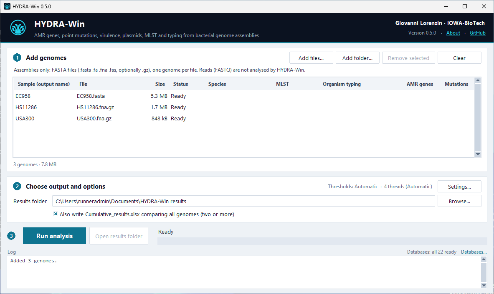
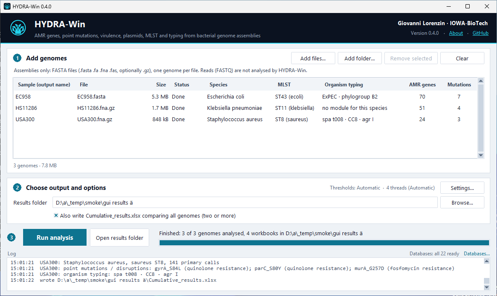
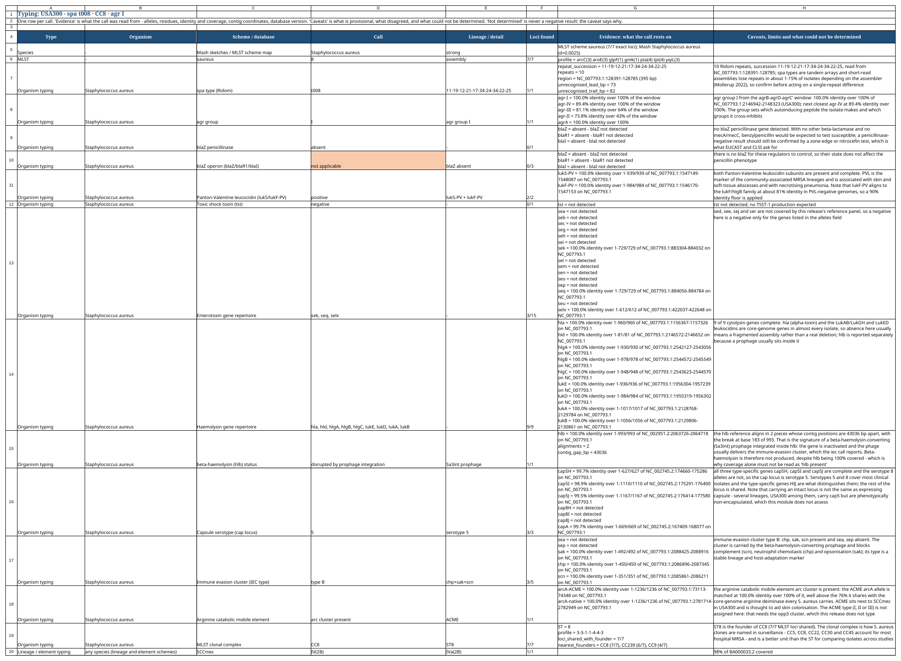

<p align="center"></p>

<h1 align="center">HYDRA-Win</h1>

<p align="center"><b>Giovanni Lorenzin · IOWA-BioTech</b></p>

<p align="center">
  <a href="https://github.com/iowa69/HYDRA-Win/releases/latest/download/HYDRA-Win-windows-x64.zip">
    
  </a>
  <br>
  <sub>One zip, about 95 MB. Unzip, double-click <code>HYDRA-Win.exe</code>. No install.</sub>
</p>

HYDRA-Win analyses bacterial genome assemblies on an ordinary Windows PC. Give it one
FASTA file per genome. For each genome it writes one Excel workbook with:

* the species and the sequence type (MLST);
* the resistance genes and resistance mutations it carries;
* its virulence genes and plasmids;
* the typing a reference laboratory reports for that organism, such as the *spa* type
  of *S. aureus* or the serotype of a pneumococcus.

There is nothing to install: no conda, no administrator rights, no console window.
After the first launch it works without internet.

> HYDRA-Win tells you what is in the genome. It does not replace susceptibility
> testing: confirm any treatment decision with a phenotypic test.

## Start in three steps

1. Click **Download** above. You get `HYDRA-Win-windows-x64.zip`.
2. Unzip it into a folder you can write to, such as *Downloads* or *Desktop*. Not
   *Program Files*.
3. Double-click `HYDRA-Win.exe`.

The first time it starts, HYDRA-Win downloads four databases it isn't allowed to ship:
CARD, the Ridom *spa* database, hicap's capsule database and ShigEiFinder. This takes a
few minutes and happens only once. If there is no internet, everything else still
works, and every result says what could not be done. See
[The first-launch download failed](#the-first-launch-download-failed) to add them later.

## Analyse your genomes

**1. Add your genomes.** Drag FASTA files or folders onto the window, or click
**Add files…** or **Add folder…**. Each genome gets a row. *Sample* is the name its
results will be saved under.

<p align="center"></p>

<p align="center"></p>

HYDRA-Win analyses **assemblies only**: `.fasta`, `.fa`, `.fna` or `.fas` files, gzipped
or not. If you add raw reads (FASTQ), they are left out and a notice says how many.
Assemble them first, for example with SPAdes or Shovill.

<p align="center"></p>

**2. Choose where the results go.** Pick a results folder. Tick
**Cumulative_results.xlsx** to also get one workbook that compares all your genomes.
Leave **Settings…** on Automatic unless you have a reason to change it (see
[Settings](#settings)).

**3. Click Run analysis.** The genomes run one after another. Each row shows its
progress, then the species, MLST, AMR genes and point mutations. If a genome fails, its
row says *Failed*, the log says why, and the other genomes carry on.

<p align="center"></p>

<p align="center"></p>

**4. Open the results.** Double-click a finished row to open its workbook, or click
**Open results folder**. Each genome has its own folder:
`<results folder>\<sample>\<sample>.xlsx`.

## Read your results correctly

Start with the **Summary** sheet. It has everything that matters for one genome, in
plain words.

<p align="center"></p>

| On the Summary | What it means |
| --- | --- |
| **Species** and **Species confidence** | The species, and how sure the call is (`strong`, `good` or `weak`). *Species evidence* says how it was made. |
| **MLST ST** | The sequence type. |
| **AMR genes** | The resistance genes found **with confidence**: complete, close enough to the reference gene, and reported by NCBI's AMRFinderPlus. These are the genes that count. |
| **AMR genes to check** | Something that looks like a resistance gene but is not established: only part of it is there, it is too different from the reference, it is cut by the end of a contig, or a stop codon or an insertion breaks it. The reason is given for each. **These are not detections.** |
| **AMR genes in other catalogues only (not counted)** | Genes that only other databases list. Most are the bacterium's own pumps and regulators, which every isolate of the species carries. They are **not** evidence of acquired resistance. |
| **Point mutations / disruptions** | Resistance mutations and broken genes, each in one sentence with the resistance it is associated with. |
| **AMR drug classes** | The drug classes with a counted gene or an established mutation behind them. |
| **Scores** | Resistance score (0-3), ESBL, carbapenemase, colistin resistance and virulence score. |
| **Organism typing** | The typing for this organism. The *Typing* sheet gives every call with its evidence. |
| **Analyses NOT performed** | Shown first, highlighted, when a database was missing. |

**Gene names.** `blaKPC-2` means the gene is identical to KPC-2.
`blaKPC (closest blaKPC-2)` means it is a KPC gene that is *not* identical to any known
variant. It may be a new variant, and one amino acid can change what it does, so do not
read it as KPC-2.

**Five things to remember:**

1. Only the **AMR genes** line lists detections. Genes to check, and genes in other
   catalogues only, are not.
2. **"Not determined" never means "absent".** It always comes with its reason: a
   database that is not installed, a gene at the edge of a contig, an incomplete profile.
3. A gene **cut by a contig end** may well be whole in the bacterium. The assembly broke
   there, so the gene could not be checked.
4. **A genotype is not a phenotype.** A gene can be silent, and resistance can have a
   cause no database knows yet. Confirm with susceptibility testing.
5. **Every result says how it was made.** The app version, the databases and their
   versions and the settings are at the bottom of the Summary, so a result can be
   reproduced later.

### The other sheets

| Sheet | What it holds |
| --- | --- |
| `AMR_genes` | Every resistance hit from every database, with its contig, position, identity and coverage. The *Confident call* column says, for each, whether it is counted, to check (and why) or not counted. |
| `Point_mutations` | Each mutation: what changed, where, and what it means. |
| `Virulence` | Virulence genes. |
| `Plasmids` | Plasmid replicons. |
| `Typing` | Every typing call, with the evidence it rests on and its caveats. |
| `All_hits` | Every hit of every kind. |
| `Pivot` | Each gene against each database, coloured by identity. |

When several databases find the same gene, one call is the primary one. The others stay
on the sheets in grey, marked `Primary call = no`, and are not counted twice. Colours
run from green (100% identity) through yellow and orange to red as identity falls.
Point mutations are blue, broken genes orange, and a gene cut by a contig end grey.

<p align="center"></p>

<p align="center"></p>

<p align="center"></p>

<p align="center"></p>

### Comparing many genomes

With **Cumulative_results.xlsx** ticked and two or more genomes, the results folder also
holds `Cumulative_results.xlsx`: a *Summary* with one row per genome, and matrices of
genomes against AMR genes, mutations, virulence genes, plasmids and typing calls.

<p align="center"></p>

<p align="center"></p>

## If something goes wrong

### I only have reads (FASTQ)

HYDRA-Win does not analyse reads. Assemble them first (for example with SPAdes or
Shovill) and add the assemblies. Upstream [Hydra](https://github.com/iowa69/hydra), on
Linux or macOS, can analyse reads.

### The first-launch download failed

HYDRA-Win uses the Windows network settings, as your browser does, including a proxy
and your hospital's certificates. If the download still fails, click **Databases…**
under the window: it shows the reason, with **Retry download**.

<p align="center"></p>

If this PC cannot reach the servers at all, copy the databases from a PC where the
download worked:

1. On that PC, copy its `db` folder (next to `HYDRA-Win.exe`, or in
   `%LOCALAPPDATA%\Hydra-win\db`) to a USB stick.
2. On this PC, click **Databases…** → **Import from folder…** and choose that folder.

Until then, analyses still run with everything else, MLST included, and every Summary
lists what was not done.

### A genome failed

Its row says *Failed*. The log in the window, and `hydra-win.log` in the results folder,
give the reason. The other genomes are not affected.

### Upgrading to a new version

Unzip the new version into its own folder. The databases an earlier version downloaded
are reused. If they are not found, the first-launch download runs again, or you can
import them from the old folder with **Import from folder…**.

## Settings

Click **Settings…**. Every setting is **Automatic** unless you untick it and enter a
value. For most work, leave them all on Automatic.

<p align="center"></p>

| Setting | Automatic | A value you enter |
| --- | --- | --- |
| Minimum % identity | 80% (95% for PlasmidFinder, 90% for EcOH) | Applies to every nucleotide database |
| Minimum % coverage | 60% of the gene (80% for EcOH) | Applies to every nucleotide database |
| Threads | All CPU cores | Changes speed only, never results |

The two thresholds decide what is *found* in the nucleotide databases. They don't change
what is *counted*: the AMR genes on the Summary follow a fixed rule, whatever the
settings. The AMRFinderPlus protein search, point mutations and typing keep their own
rules. The settings used are recorded on every Summary.

## Command line

```
HYDRA-Win.exe --cli genome1.fasta genome2.fna.gz --out C:\results --cumulative
HYDRA-Win.exe --cli C:\assemblies --out C:\results
```

This runs exactly what the window runs.

| Option | What it does |
| --- | --- |
| `--out FOLDER` | Where the results go (required) |
| `--cumulative` | Also write `Cumulative_results.xlsx` |
| `--min-identity PCT`, `--min-coverage PCT` | The two settings above (default: Automatic) |
| `--threads N` | Number of threads (default: all cores) |
| `--offline` | Don't download missing databases |
| `--log FILE` | Also write the log to `FILE` |
| `--db-status` | Show which databases are installed, and why a missing one failed |
| `--fetch-db` | Download the first-launch databases, then exit |
| `--import-db FOLDER` | Install the first-launch databases from a folder copied from another PC, then exit |
| `--version` | Print the version |

FASTQ files are skipped with one warning. The exit code is non-zero if any genome
failed.

## More detail

* [How HYDRA-Win makes its calls](docs/how-it-works.md): the rules for resistance
  genes, point mutations and species, the typing for each organism and its limits, and
  what HYDRA-Win does and does not include.
* [Databases and licences](docs/databases.md): every database, where it comes from, its
  licence and its citation.
* [Building and testing](docs/building.md): how the release is built and tested, and
  how to run HYDRA-Win from source.

## Credit and licence

HYDRA-Win is by Giovanni Lorenzin · IOWA-BioTech and is MIT-licensed (see `LICENSE`).
The analysis is upstream [Hydra](https://github.com/iowa69/hydra), also MIT; its
licence is kept in `src/hydra_amr/LICENSE`. The logo is upstream Hydra's. Please cite
Hydra and the databases you rely on (see [Databases and licences](docs/databases.md)).
