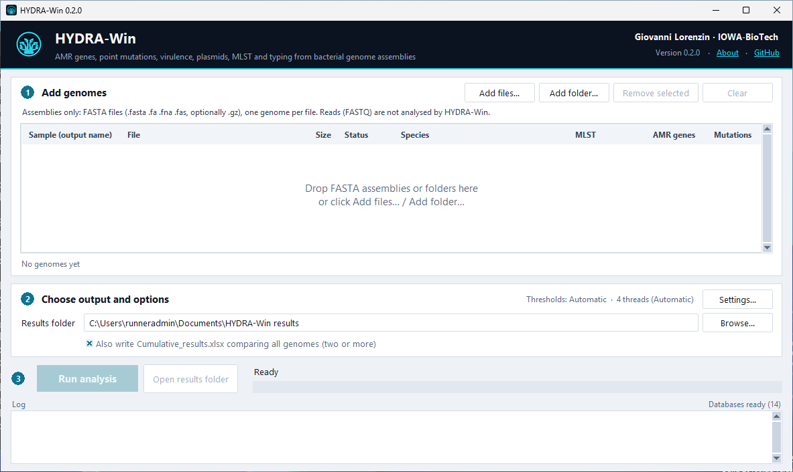
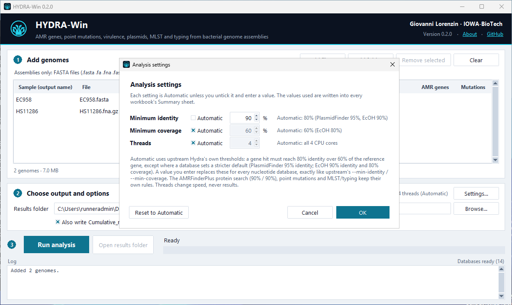
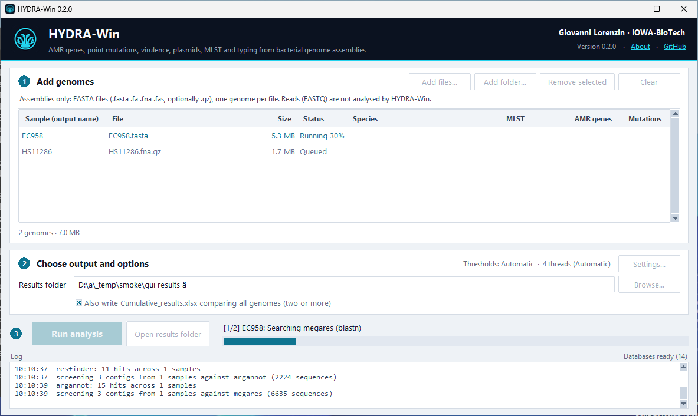
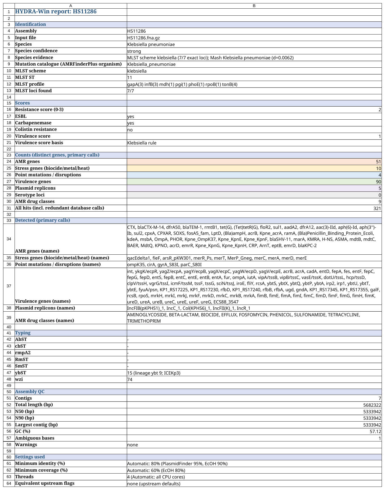
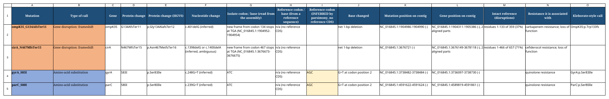
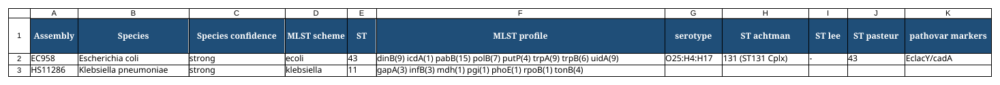

<p align="center"></p>

<h1 align="center">HYDRA-Win</h1>

<p align="center"><b>Giovanni Lorenzin · IOWA-BioTech</b></p>

<p align="center">
  <a href="https://github.com/iowa69/HYDRA-Win/releases/latest/download/HYDRA-Win-windows-x64.zip">
    
  </a>
  <br>
  <sub>One zip, about 70 MB. Unzip, double-click <code>HYDRA-Win.exe</code>. No install.</sub>
</p>

A portable Windows app for the bacterial genome analyser
[Hydra](https://github.com/iowa69/hydra). Give it genome assemblies (FASTA; reads
aren't analysed, see [Assemblies only](#assemblies-only)) and it reports
acquired AMR genes, resistance point mutations, virulence factors, plasmid replicons,
MLST, lineage and serotype typing, and resistance/virulence scores, in one Excel
workbook per genome.

You don't install anything. There's no conda, no admin rights and no console window.

## Screenshots

The window is shown as the release workflow captured it on Windows, on a 1366×768
screen, while it drove the real app through an analysis of two public genomes,
*K. pneumoniae* HS11286 and *E. coli* EC958. The report views are the workbooks that
run produced.

**1. Add genomes.** The window opens with three steps: add genomes, choose output and
options, run. It says up front that it analyses assemblies only.

<p align="center"></p>

**Genomes loaded.** One row per genome. *Sample* is the name its results folder and
workbook will get.

<p align="center"></p>

**2. Settings.** Minimum % identity, minimum % coverage and threads, each Automatic
unless you enter a value (see [Settings](#settings)).

<p align="center"></p>

**FASTQ files are not added.** Dropping a folder of reads gives one notice with the
count.

<p align="center"></p>

**3. Run.** Each row shows its status live.

<p align="center"></p>

**Finished.** Species, MLST, AMR genes and point mutations fill in as each genome
finishes. Double-click a row to open its workbook.

<p align="center"></p>

**Pivot sheet:** every locus against every database, shaded by % identity, with its location.

<p align="center"></p>

**Summary sheet:** species, MLST, scores, typing and counts for one genome.

<p align="center"></p>

**AMR_genes sheet:** the raw hits, each with contig, start, end and strand.

<p align="center"></p>

**Point_mutations sheet**

<p align="center"></p>

**Plasmids sheet**

<p align="center"></p>

**Cumulative_results, Summary:** one row per assembly.

<p align="center"></p>

**Cumulative_results, AMR matrix:** assemblies against genes, grouped by drug class.

<p align="center"></p>

**Cumulative_results, Mutations matrix**

<p align="center"></p>

## Get started

1. Click the green **Download** button above (or get `HYDRA-Win-windows-x64.zip` from
   [Releases](https://github.com/iowa69/HYDRA-Win/releases)).
2. Unzip it into a folder you can write to, for example *Downloads* or *Desktop*
   (not *Program Files*).
3. Double-click `HYDRA-Win.exe`.

The first time it starts, HYDRA-Win downloads the databases it isn't allowed to
redistribute (see [Databases](#databases)). This needs an internet connection and takes
a few minutes. It only happens once.

**Using it:**

1. **Add genomes.** Drag FASTA files or folders onto the window, or click
   **Add files…** or **Add folder…** (folders are searched recursively). Each genome
   gets a row. Its *Sample* name comes from the file name, and its results go to
   `<results>\<sample>\<sample>.xlsx`. When two files have the same name, the second
   becomes `<name>_2`, the third `<name>_3`, and so on. Those rows are highlighted, so
   no result is overwritten.
2. **Choose output and options.** Pick a results folder. Tick
   **Cumulative_results.xlsx** if you want an extra workbook comparing all the genomes.
   **Settings…** changes the thresholds and threads (all Automatic by default).
3. **Run analysis.** Genomes are analysed one after another. Each row goes from
   *Queued* to *Running* to *Done*, and then shows the species, MLST, number of AMR
   genes and number of point mutations. A genome that fails is marked *Failed* (the log
   says why) and the others still run. Double-click a finished row to open its
   workbook, or click **Open results folder**.

The header's **About** link shows the version, credits and licences.

### Assemblies only

HYDRA-Win analyses **assembled genomes**: one FASTA file per genome (`.fasta`, `.fa`,
`.fna` or `.fas`, each optionally gzipped). It does **not** analyse reads.

If you drop or select FASTQ files (`.fastq` or `.fq`, compressed or not), HYDRA-Win
doesn't add them, and one notice says how many were left out. Their names don't matter:
a FASTQ file is never matched to an assembly or used in any way, whether or not it
shares the assembly's name. To analyse reads, assemble them first (for example with
SPAdes or Shovill) and add the assemblies, or use upstream
[Hydra](https://github.com/iowa69/hydra) on Linux or macOS, which has a reads mode.

### Settings

Click **Settings…**. Every setting is **Automatic** unless you untick it and enter a
value.

| Setting | Automatic | A value you enter |
| --- | --- | --- |
| Minimum % identity | Upstream Hydra's defaults: 80% for the nucleotide databases, except PlasmidFinder (95%) and EcOH (90%), which have stricter defaults of their own | Applies to every nucleotide database and replaces those defaults, exactly like upstream's `--min-identity` |
| Minimum % coverage | 60% of the reference gene, except EcOH (80%) | Applies to every nucleotide database, like upstream's `--min-coverage` |
| Threads | All CPU cores | Changes speed only, never results |

The two thresholds filter the nucleotide searches: NCBI, CARD, ResFinder, ARG-ANNOT,
MEGARes, VFDB, *E. coli* VF, PlasmidFinder and EcOH. As in upstream, the AMRFinderPlus
protein search keeps its own 90% identity / 90% coverage, and point mutations and
MLST/typing keep their own rules. Values go from 0 to 100, with decimals allowed
(`92.5` or `92,5`).

Every workbook's `Summary` sheet records the settings used in a *Settings used*
section, together with the equivalent upstream flags. `Cumulative_results.xlsx`
records them under its summary table. Any result can be traced to its thresholds.

### Headless mode

```
HYDRA-Win.exe --cli genome1.fasta genome2.fna.gz --out C:\results --cumulative
HYDRA-Win.exe --cli C:\assemblies --out C:\results --min-identity 90 --min-coverage 80
```

This runs the same code path as the window. Other options:

| Option | What it does |
| --- | --- |
| `--min-identity PCT` | Minimum % identity (default: Automatic, as above) |
| `--min-coverage PCT` | Minimum % coverage (default: Automatic, as above) |
| `--threads N` | Number of threads to use (default: all cores) |
| `--offline` | Don't download missing databases |
| `--log FILE` | Also write the log to `FILE` |
| `--db-status` | Report which databases are installed |
| `--fetch-db` | Download the first-launch databases, then exit |
| `--version` | Print the version |

FASTQ inputs are skipped with one warning. The exit code is non-zero if any genome
failed. Every run also writes `hydra-win.log` into the results folder.

### Upgrading from 0.1.0

Unzip 0.2.0 into its own folder. Version 0.1.0 kept its databases inside its own folder
when it could write there; 0.2.0 downloads those again on its first launch (a few
minutes). When 0.1.0 couldn't write to its folder, it kept them in
`%LOCALAPPDATA%\Hydra-win`, and 0.2.0 reuses them from there instead of downloading.

## Output

For each genome, `<results>\<genome>\<genome>.xlsx` contains these sheets:

| Sheet | Contents |
| --- | --- |
| `Summary` | Species, MLST scheme/ST/profile, scores (resistance 0-3, ESBL, carbapenemase, colistin, virulence), counts per category, detected genes per category, lineage/serotype typing, assembly QC, the settings used, and database versions and thresholds |
| `AMR_genes` | Every acquired AMR hit and every stress hit (biocide/metal/heat) |
| `Point_mutations` | Resistance point mutations and gene disruptions, with the mutation (for example `gyrA_S83I`) |
| `Virulence` | Virulence factor hits |
| `Plasmids` | Plasmid replicon hits |
| `Typing` | Species call, MLST, every lineage/serotype/element scheme, and serotype loci |
| `All_hits` | Every hit in every category |
| `Pivot` | One row per locus, grouped by category and drug class, with one column per database. Each cell holds that database's % identity and is colour-coded |

Every hit row has the contig, start, end and strand, plus gene, database, % identity,
% coverage, drug class/subclass, product, accession, element type, method, resolution
and note.

When several databases find the same locus, upstream Hydra marks one call as primary.
The other calls stay in the sheets in grey, with `Primary call = no`. They aren't
counted.

Colours: green for 100% identity, then light green, yellow, orange and red as identity
falls. Point mutations are blue. Italic means partial coverage.

With **Cumulative_results** (and two or more genomes), `<results>\Cumulative_results.xlsx`
contains:

| Sheet | Contents |
| --- | --- |
| `Summary` | One row per assembly |
| `AMR_matrix` | Assembly × gene matrix of primary calls, colour-coded by identity, with the drug class above each gene |
| `Mutations_matrix` | Same layout, for point mutations |
| `Virulence_matrix` | Same layout, for virulence genes |
| `Plasmids_matrix` | Same layout, for plasmid replicons |
| `All_hits` | Every hit, with an `Assembly` column |

## What is (and isn't) included

HYDRA-Win runs upstream Hydra's own analysis code. It uses a pinned copy of
`hydra_amr` from [iowa69/hydra](https://github.com/iowa69/hydra) at commit `6d36c10`,
with two small, documented Windows patches (see `src/hydra_amr/VENDORED.txt`). With
Automatic settings, the analysis matches upstream's `--preset deep`:

* every installed gene database
* AMRFinderPlus translated search with `--plus` elements
* point mutations
* MLST
* lineage and element typing
* scores

Two pieces are added for Windows:

* **Species identification.** Upstream uses Mash, which has no Windows build.
  HYDRA-Win includes a pure-Python re-implementation of `mash dist` and runs it against
  Kleborate's species sketches. It gives the same shared-hash counts as Mash 2.3 on the
  test genomes. Upstream's species rules are then applied unchanged. Without it,
  upstream's MLST-only fallback names some *Klebsiella* genomes as *E. coli*.
* **BLAST+ path handling.** BLAST+ on Windows can't cope with spaces or non-ASCII
  characters in paths. HYDRA-Win runs it from an ASCII, space-free folder (the 8.3
  short name, or `%LOCALAPPDATA%\Hydra-win`) and passes it relative paths, so the app
  works from folders like `C:\Users\Jörg Müller\Downloads`. Its databases are built in
  BLAST's version-4 format, which has no LMDB index; on Windows each LMDB file takes up
  its full gigabyte-sized map.

**Limitations**

* **Reads aren't supported** (see [Assemblies only](#assemblies-only)). There's no
  FASTQ input and no heteroresistance or allele-fraction analysis. Upstream's read mode needs minimap2, samtools and pysam,
  and none of them runs natively on Windows. Use upstream Hydra on Linux or macOS for
  reads.
* **`vfdb_full` isn't used.** Upstream can't download it automatically, it overlaps
  with the core VFDB set, and it's by far the slowest search.
* The species sketches cover Enterobacterales. Other genera are named from their MLST
  scheme, as in upstream.
* PubMLST, CARD, VFDB, ARG-ANNOT, MEGARes, *E. coli* VF and EcOH need an internet
  connection on the first launch.

## Databases

The release workflow builds databases from their upstream sources with upstream
Hydra's own fetchers. Whether a database ships inside the zip depends on its licence.

| Database | How you get it | Licence / terms | Citation |
| --- | --- | --- | --- |
| NCBI AMRFinderPlus (protein, point mutations, nucleotide) | in the zip | Public domain | Feldgarden et al. 2021, Sci Rep 11:12728 |
| ResFinder | in the zip | Apache-2.0 | Bortolaia et al. 2020, J Antimicrob Chemother 75:3491 |
| PlasmidFinder | in the zip | Apache-2.0 | Carattoli et al. 2014, Antimicrob Agents Chemother 58:3895 |
| SCCmecFinder | in the zip | Apache-2.0 | Kaya et al. 2018, mSphere 3:e00612-17 |
| Kleborate typing loci and species sketches (v3.2.4) | in the zip | GPL-3.0 | Lam et al. 2021, Nat Commun 12:4188; Ondov et al. 2016, Genome Biol 17:132 |
| PubMLST 7-locus schemes | first launch | PubMLST terms (redistribution of downloaded data restricted since 2025) | Jolley, Bray & Maiden 2018, Wellcome Open Res 3:124 |
| CARD | first launch | CARD terms (free for academic/non-commercial use, no redistribution) | Alcock et al. 2023, Nucleic Acids Res 51:D690 |
| VFDB (core) | first launch | No redistribution licence stated | Liu et al. 2022, Nucleic Acids Res 50:D912 |
| ARG-ANNOT | first launch, from abricate's repository | No redistribution licence stated | Gupta et al. 2014, Antimicrob Agents Chemother 58:212 |
| MEGARes | first launch, from abricate's repository | No redistribution licence stated | Bonin et al. 2023, Nucleic Acids Res 51:D744 |
| *E. coli* VF | first launch, from abricate's repository | No explicit data licence | [phac-nml/ecoli_vf](https://github.com/phac-nml/ecoli_vf) |
| EcOH | first launch, from abricate's repository | No explicit data licence | Ingle et al. 2016, Microb Genom 2:e000064 |

The `db` folder in the zip contains `DATABASES.txt` and the licence texts.

If a first-launch download fails, the analysis still runs with the databases that are
available. The `Summary` sheet lists what was missing, and the download is retried on
the next run. Commercial users must check the CARD and PubMLST terms themselves.

NCBI BLAST+ 2.16.0 is in the zip under `blast\`. It's public domain; see
`blast\LICENSE`. It comes with the Microsoft Visual C++ runtime DLLs it needs, which
are deployed app-locally.

## Building

The Windows build runs on GitHub Actions (`.github/workflows/build.yml`) and goes
through these steps:

1. Unit tests
2. PyInstaller (`--onedir`, windowed)
3. BLAST+
4. Database build with the packaged exe
5. Zip
6. Smoke test of the packaged exe: first launch, then `--cli --cumulative` on two public
   NCBI genomes (*K. pneumoniae* HS11286 and *E. coli* EC958), with assertions on
   sheets, hits, coordinates and known genes and mutations, then a `--cli` run with
   custom thresholds and a folder of FASTQ files among the inputs
7. Window test on a 1366×768 screen: the packaged app is driven through its widgets
   (add genomes, settings, a FASTQ drop, **Run analysis**) until the table shows the
   results. The test checks the table, the workbooks (the same hits as the `--cli` run)
   and that the window and its log fit on the screen, and it saves the window
   screenshots shown above

A `v*` tag publishes the zip as a release.

To run from source (Linux, macOS or Windows), with BLAST+ on `PATH`:

```
pip install -r requirements.txt
python -m hydra_win             # window
python -m hydra_win --cli ...   # headless
python -m pytest -q
```

`tools/compare_upstream.py` checks a HYDRA-Win output folder against upstream
`hydra run --preset deep --format json` on the same genomes and databases. For custom
thresholds, give both the same `--min-identity` / `--min-coverage`.

## Credit and licence

HYDRA-Win is by Giovanni Lorenzin · IOWA-BioTech and is MIT-licensed (see `LICENSE`).
The logo is upstream Hydra's. The analysis is upstream
[Hydra](https://github.com/iowa69/hydra), also MIT; its licence is kept in
`src/hydra_amr/LICENSE`. Please cite Hydra and the databases you rely on.
