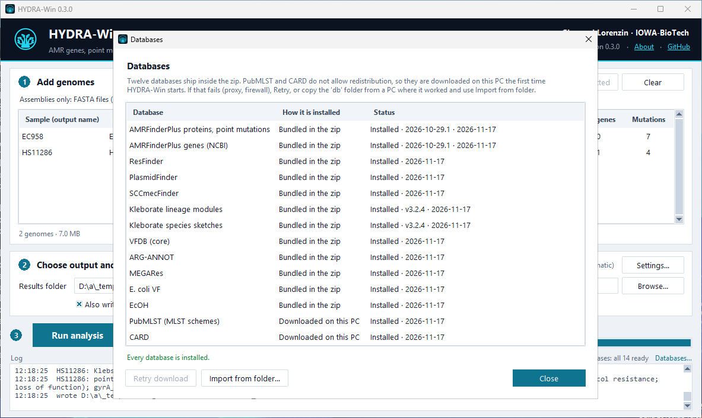
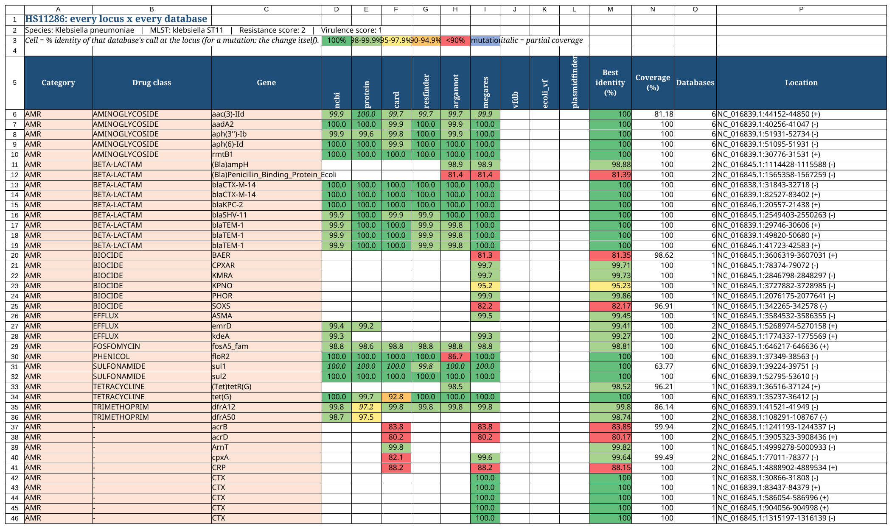
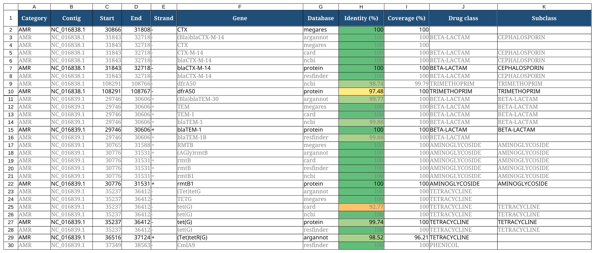
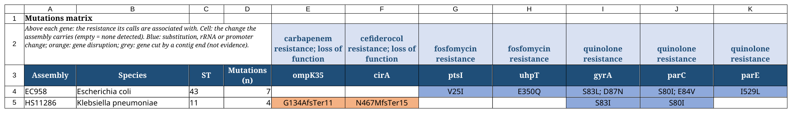

<p align="center"></p>

<h1 align="center">HYDRA-Win</h1>

<p align="center"><b>Giovanni Lorenzin · IOWA-BioTech</b></p>

<p align="center">
  <a href="https://github.com/iowa69/HYDRA-Win/releases/latest/download/HYDRA-Win-windows-x64.zip">
    
  </a>
  <br>
  <sub>One zip, about 78 MB. Unzip, double-click <code>HYDRA-Win.exe</code>. No install.</sub>
</p>

A portable Windows app for the bacterial genome analyser
[Hydra](https://github.com/iowa69/hydra). Give it genome assemblies (FASTA; reads
aren't analysed, see [Assemblies only](#assemblies-only)) and it reports
acquired AMR genes, resistance point mutations, virulence factors, plasmid replicons,
MLST, lineage and serotype typing, and resistance/virulence scores, in one Excel
workbook per genome.

You don't install anything. There's no conda, no admin rights and no console window.

## Screenshots

The window is shown as the release workflow captured it on Windows, on a 1366×768
screen, while it drove the real app through an analysis of two public genomes,
*K. pneumoniae* HS11286 and *E. coli* EC958. The report views are the workbooks that
run produced.

**1. Add genomes.** The window opens with three steps: add genomes, choose output and
options, run. It says up front that it analyses assemblies only.

<p align="center"></p>

**Genomes loaded.** One row per genome. *Sample* is the name its results folder and
workbook will get.

<p align="center"></p>

**2. Settings.** Minimum % identity, minimum % coverage and threads, each Automatic
unless you enter a value (see [Settings](#settings)).

<p align="center"></p>

**FASTQ files are not added.** Dropping a folder of reads gives one notice with the
count.

<p align="center"></p>

**3. Run.** Each row shows its status live.

<p align="center"></p>

**Finished.** Species, MLST, AMR genes and point mutations fill in as each genome
finishes, and the log lists each mutation with the resistance it is associated with.
Double-click a row to open its workbook.

<p align="center"></p>

**Databases.** Click **Databases…** under the window: every database, whether it
ships in the zip or is downloaded on this PC, and, for one that is missing, the real
reason the download failed, with **Retry download** and **Import from folder…** (see
[When a download fails](#when-a-download-fails)).

<p align="center"></p>

**Pivot sheet:** every locus against every database, shaded by % identity, with its location.

<p align="center"></p>

**Summary sheet:** species, MLST, scores, typing and counts for one genome, and each
point mutation or gene disruption in one plain sentence.

<p align="center"></p>

**AMR_genes sheet:** the raw hits, each with contig, start, end and strand.

<p align="center"></p>

**Point_mutations sheet:** what mutated, read from the assembly, and what it means
(see [Point mutations and gene disruptions](#point-mutations-and-gene-disruptions)).

<p align="center"></p>

**Plasmids sheet**

<p align="center"></p>

**Cumulative_results, Summary:** one row per assembly.

<p align="center"></p>

**Cumulative_results, AMR matrix:** assemblies against genes, grouped by drug class.

<p align="center"></p>

**Cumulative_results, Mutations matrix:** assemblies against genes; each cell states
the change the assembly carries, with the resistance above each gene.

<p align="center"></p>

## Get started

1. Click the green **Download** button above (or get `HYDRA-Win-windows-x64.zip` from
   [Releases](https://github.com/iowa69/HYDRA-Win/releases)).
2. Unzip it into a folder you can write to, for example *Downloads* or *Desktop*
   (not *Program Files*).
3. Double-click `HYDRA-Win.exe`.

Twelve of the fourteen databases are in the zip. The first time it starts, HYDRA-Win
downloads the two it isn't allowed to redistribute, PubMLST (for MLST) and CARD (see
[Databases](#databases)). This needs an internet connection and takes a few minutes. It
only happens once. Everything else works without them, and every workbook says what
was not done (see [When a download fails](#when-a-download-fails)).

**Using it:**

1. **Add genomes.** Drag FASTA files or folders onto the window, or click
   **Add files…** or **Add folder…** (folders are searched recursively). Each genome
   gets a row. Its *Sample* name comes from the file name, and its results go to
   `<results>\<sample>\<sample>.xlsx`. When two files have the same name, the second
   becomes `<name>_2`, the third `<name>_3`, and so on. Those rows are highlighted, so
   no result is overwritten.
2. **Choose output and options.** Pick a results folder. Tick
   **Cumulative_results.xlsx** if you want an extra workbook comparing all the genomes.
   **Settings…** changes the thresholds and threads (all Automatic by default).
3. **Run analysis.** Genomes are analysed one after another. Each row goes from
   *Queued* to *Running* to *Done*, and then shows the species, MLST, number of AMR
   genes and number of point mutations. A genome that fails is marked *Failed* (the log
   says why) and the others still run. Double-click a finished row to open its
   workbook, or click **Open results folder**.

The header's **About** link shows the version, credits and licences.

### Assemblies only

HYDRA-Win analyses **assembled genomes**: one FASTA file per genome (`.fasta`, `.fa`,
`.fna` or `.fas`, each optionally gzipped). It does **not** analyse reads.

If you drop or select FASTQ files (`.fastq` or `.fq`, compressed or not), HYDRA-Win
doesn't add them, and one notice says how many were left out. Their names don't matter:
a FASTQ file is never matched to an assembly or used in any way, whether or not it
shares the assembly's name. To analyse reads, assemble them first (for example with
SPAdes or Shovill) and add the assemblies, or use upstream
[Hydra](https://github.com/iowa69/hydra) on Linux or macOS, which has a reads mode.

### Settings

Click **Settings…**. Every setting is **Automatic** unless you untick it and enter a
value.

| Setting | Automatic | A value you enter |
| --- | --- | --- |
| Minimum % identity | Upstream Hydra's defaults: 80% for the nucleotide databases, except PlasmidFinder (95%) and EcOH (90%), which have stricter defaults of their own | Applies to every nucleotide database and replaces those defaults, exactly like upstream's `--min-identity` |
| Minimum % coverage | 60% of the reference gene, except EcOH (80%) | Applies to every nucleotide database, like upstream's `--min-coverage` |
| Threads | All CPU cores | Changes speed only, never results |

The two thresholds filter the nucleotide searches: NCBI, CARD, ResFinder, ARG-ANNOT,
MEGARes, VFDB, *E. coli* VF, PlasmidFinder and EcOH. As in upstream, the AMRFinderPlus
protein search keeps its own 90% identity / 90% coverage, and point mutations and
MLST/typing keep their own rules. Values go from 0 to 100, with decimals allowed
(`92.5` or `92,5`).

Every workbook's `Summary` sheet records the settings used in a *Settings used*
section, together with the equivalent upstream flags. `Cumulative_results.xlsx`
records them under its summary table. Any result can be traced to its thresholds.

### Headless mode

```
HYDRA-Win.exe --cli genome1.fasta genome2.fna.gz --out C:\results --cumulative
HYDRA-Win.exe --cli C:\assemblies --out C:\results --min-identity 90 --min-coverage 80
```

This runs the same code path as the window. Other options:

| Option | What it does |
| --- | --- |
| `--min-identity PCT` | Minimum % identity (default: Automatic, as above) |
| `--min-coverage PCT` | Minimum % coverage (default: Automatic, as above) |
| `--threads N` | Number of threads to use (default: all cores) |
| `--offline` | Don't download missing databases |
| `--log FILE` | Also write the log to `FILE` |
| `--db-status` | Report which databases are installed, and why a missing one failed |
| `--fetch-db` | Download the first-launch databases, then exit |
| `--import-db FOLDER` | Install PubMLST and CARD from a folder copied from another PC, then exit |
| `--version` | Print the version |

FASTQ inputs are skipped with one warning. The exit code is non-zero if any genome
failed. Every run also writes `hydra-win.log` into the results folder.

### When a download fails

Only PubMLST and CARD are downloaded. HYDRA-Win uses the Windows network settings, as
your browser does: the system proxy (including automatic proxy configuration scripts),
the Windows certificate store (so a hospital network that inspects HTTPS works), and,
if Python's own connection is refused, Windows' own downloader with your logon
credentials (for proxies that ask for them). Each download is retried, and the reason
for a failure (an HTTP status, an untrusted certificate, a timeout, a proxy refusal, a
name that does not resolve) is written to the log and shown under **Databases…**.

If this PC still cannot reach the servers:

1. On a PC where HYDRA-Win downloaded them (same or newer version), copy its `db`
   folder (next to `HYDRA-Win.exe`, or `%LOCALAPPDATA%\Hydra-win\db`) to a USB stick.
2. On this PC, open **Databases…** → **Import from folder…** and choose that folder
   (or the whole HYDRA-Win folder), or run `HYDRA-Win.exe --import-db E:\db`.

Without them, analyses still run with the other twelve databases. The window, the
log and every `Summary` sheet state what was not done, for example *NO MLST: the
PubMLST schemes are not installed, so no sequence type was determined; an empty ST is
not a negative result*, and the MLST cell reads *not typed* rather than staying empty.

### Upgrading

Unzip the new version into its own folder. Databases an earlier version downloaded
into `%LOCALAPPDATA%\Hydra-win` are reused; otherwise PubMLST and CARD are downloaded
again on the first launch, or can be imported from the old folder with
**Import from folder…**.

## Output

For each genome, `<results>\<genome>\<genome>.xlsx` contains these sheets:

| Sheet | Contents |
| --- | --- |
| `Summary` | Any analysis not performed because a database is missing (first, highlighted), species, MLST scheme/ST/profile, scores (resistance 0-3, ESBL, carbapenemase, colistin, virulence), counts per category, detected genes per category, each point mutation and disruption in one sentence with its resistance, lineage/serotype typing, assembly QC, the settings used, and database versions and thresholds |
| `AMR_genes` | Every acquired AMR hit and every stress hit (biocide/metal/heat) |
| `Point_mutations` | Resistance point mutations and gene disruptions: what changed, where and what it means first, then the raw hit columns (see below) |
| `Virulence` | Virulence factor hits |
| `Plasmids` | Plasmid replicon hits |
| `Typing` | Species call, MLST, every lineage/serotype/element scheme, and serotype loci |
| `All_hits` | Every hit in every category; mutation calls carry a one-line *Mutation: what changed* |
| `Pivot` | One row per locus, grouped by category and drug class, with one column per database. Each cell holds that database's % identity and is colour-coded; for a mutation it holds the change itself (`S83I`, `G134AfsTer11`) |

Every hit row has the contig, start, end and strand, plus gene, database, % identity,
% coverage, drug class/subclass, product, accession, element type, method, resolution
and note.

When several databases find the same locus, upstream Hydra marks one call as primary.
The other calls stay in the sheets in grey, with `Primary call = no`. They aren't
counted.

Colours: green for 100% identity, then light green, yellow, orange and red as identity
falls. Point mutations are blue, gene disruptions orange, and a gene cut by a contig
end grey. Italic means partial coverage.

### Point mutations and gene disruptions

Every call in `Point_mutations` states, without decoding:

| Column | Example (HS11286 *gyrA*) | Example (HS11286 *ompK35*) |
| --- | --- | --- |
| Mutation (AMRFinderPlus name) | `gyrA_S83I` | `ompK35_G134AfsTer11` |
| Type of call | Amino-acid substitution | Gene disruption: frameshift |
| Protein change / HGVS | `S83I` / `p.Ser83Ile` | `G134AfsTer11` / `p.Gly134AlafsTer12` |
| Nucleotide change | `c.248G>T (inferred)` | `c.401delG (inferred)` |
| Isolate codon / base (read from the assembly) | `ATC` | new frame from codon 134 stops at `TGA` (NC_016845.1:1904952-1904954) |
| Reference codon (INFERRED by parsimony) | `AGC` | |
| Base changed | G>T at codon position 2 | net 1-bp deletion |
| Mutation position on contig | NC_016845.1:3738482-3738484 (-) | NC_016845.1:1904986-1904990 (-) |
| Intact reference | | residues 1-133 of 359 (37%) |
| Resistance it is associated with | quinolone resistance | carbapenem resistance; loss of function |
| Kleborate-style call | `GyrA:p.Ser83Ile` | `OmpK35:p.Trp133fs` |

followed by *What it means* (one sentence), *Basis of the base change* and *Not
resolved*, then the raw hit columns.

* **The isolate's codon is read from the assembly**: the alignment is walked to the
  mutated residue, so the strand, indels before the position and contig ends are
  handled, and the codon is re-translated as a check.
* **Where the reference base comes from.** For the DNA loci of the AMRFinderPlus
  catalogue (rRNA, promoters) it is read from the catalogue's reference sequence.
  AMRFinderPlus ships proteins, not coding sequences, for the point-mutation genes, so
  for a protein mutation (and the codon behind a premature stop or frameshift) the
  reference codon is the codon for the reference amino acid closest to the isolate's
  codon. That is an inference: it has its own column, the nucleotide change is marked
  *(inferred)*, and when two codons are equally close nothing is claimed.
* **Gene disruptions are named by their lesion**, the way AMRFinderPlus names them
  (`ompK35_G134AfsTer11`, `mgrB_Q30Ter`): premature stop (codon and base change),
  frameshift (the net indel, where the new frame stops, the HGVS `fsTer`, and the
  deleted or inserted base when only one change restores the protein, marked
  *inferred*), interruption by inserted sequence (its size; the element itself is not
  identified), start codon lost, or 5' part absent. A gene that simply runs off the end
  of a contig is labelled **Gene cut by a contig end (NOT evidence of disruption)**,
  which AMRFinderPlus reports as `PARTIAL_CONTIG_END`. AMRFinderPlus counts the novel
  residues before the stop (`fsTer11`); HGVS counts the stop as well (`fsTer12`).
* **Kleborate's name** is given for the *K. pneumoniae* loci Kleborate types (GyrA,
  ParC, OmpK35, OmpK36, MgrB, PmrB).
* Anything that cannot be resolved to a codon (a position in an alignment gap, a codon
  past a contig end, a mosaic allele) says so in *Not resolved*.

With **Cumulative_results** (and two or more genomes), `<results>\Cumulative_results.xlsx`
contains:

| Sheet | Contents |
| --- | --- |
| `Summary` | One row per assembly, with each mutation and its resistance |
| `AMR_matrix` | Assembly × gene matrix of primary calls, colour-coded by identity, with the drug class above each gene |
| `Mutations_matrix` | Assembly × gene; each cell states the change(s) the assembly carries (`S83L; D87N`, `G134AfsTer11`), with the resistance above each gene |
| `Virulence_matrix` | Same layout, for virulence genes |
| `Plasmids_matrix` | Same layout, for plasmid replicons |
| `All_hits` | Every hit, with an `Assembly` column |

## What is (and isn't) included

HYDRA-Win runs upstream Hydra's own analysis code. It uses a pinned copy of
`hydra_amr` from [iowa69/hydra](https://github.com/iowa69/hydra) at commit `6d36c10`,
with two small, documented Windows patches and the mutation-detail change proposed to
upstream (see `src/hydra_amr/VENDORED.txt`). With Automatic settings, the calls match
upstream's `--preset deep`:

* every installed gene database
* AMRFinderPlus translated search with `--plus` elements
* point mutations
* MLST
* lineage and element typing
* scores

Two pieces are added for Windows:

* **Species identification.** Upstream uses Mash, which has no Windows build.
  HYDRA-Win includes a pure-Python re-implementation of `mash dist` and runs it against
  Kleborate's species sketches. It gives the same shared-hash counts as Mash 2.3 on the
  test genomes. Upstream's species rules are then applied unchanged. Without it,
  upstream's MLST-only fallback names some *Klebsiella* genomes as *E. coli*.
* **BLAST+ path handling.** BLAST+ on Windows can't cope with spaces or non-ASCII
  characters in paths. HYDRA-Win runs it from an ASCII, space-free folder (the 8.3
  short name, or `%LOCALAPPDATA%\Hydra-win`) and passes it relative paths, so the app
  works from folders like `C:\Users\Jörg Müller\Downloads`. Its databases are built in
  BLAST's version-4 format, which has no LMDB index; on Windows each LMDB file takes up
  its full gigabyte-sized map.

**Limitations**

* **Reads aren't supported** (see [Assemblies only](#assemblies-only)). There's no
  FASTQ input and no heteroresistance or allele-fraction analysis. Upstream's read mode needs minimap2, samtools and pysam,
  and none of them runs natively on Windows. Use upstream Hydra on Linux or macOS for
  reads.
* **`vfdb_full` isn't used.** Upstream can't download it automatically, it overlaps
  with the core VFDB set, and it's by far the slowest search.
* The species sketches cover Enterobacterales. Other genera are named from their MLST
  scheme, as in upstream.
* PubMLST and CARD need an internet connection on the first launch, or a copy
  imported from another PC.

## Databases

The release workflow builds the databases from their upstream sources with upstream
Hydra's own fetchers, on the date recorded in `db\DATABASES.txt`. Twelve ship inside
the zip; the two whose terms restrict redistribution are downloaded on your PC.

| Database | How you get it | Licence / terms | Citation |
| --- | --- | --- | --- |
| NCBI AMRFinderPlus (protein, point mutations, nucleotide) | in the zip | Public domain | Feldgarden et al. 2021, Sci Rep 11:12728 |
| ResFinder | in the zip | Apache-2.0 | Bortolaia et al. 2020, J Antimicrob Chemother 75:3491 |
| PlasmidFinder | in the zip | Apache-2.0 | Carattoli et al. 2014, Antimicrob Agents Chemother 58:3895 |
| SCCmecFinder | in the zip | Apache-2.0 | Kaya et al. 2018, mSphere 3:e00612-17 |
| Kleborate typing loci and species sketches (v3.2.4) | in the zip | GPL-3.0 | Lam et al. 2021, Nat Commun 12:4188; Ondov et al. 2016, Genome Biol 17:132 |
| VFDB (core) | in the zip, from VFDB (`VFDB_setA_nt.fas.gz`) | The source states no licence | Liu et al. 2022, Nucleic Acids Res 50:D912 |
| ARG-ANNOT | in the zip, from abricate's repository (pinned commit) | The source states no licence | Gupta et al. 2014, Antimicrob Agents Chemother 58:212 |
| MEGARes | in the zip, from abricate's repository (pinned commit) | The source states no licence | Bonin et al. 2023, Nucleic Acids Res 51:D744 |
| *E. coli* VF | in the zip, from abricate's repository (pinned commit) | The source states no licence | [phac-nml/ecoli_vf](https://github.com/phac-nml/ecoli_vf) |
| EcOH | in the zip, from abricate's repository (pinned commit) | The source states no licence | Ingle et al. 2016, Microb Genom 2:e000064 |
| PubMLST 7-locus schemes | downloaded on first launch | PubMLST terms: data downloaded since 2025 may not be redistributed or repackaged | Jolley, Bray & Maiden 2018, Wellcome Open Res 3:124 |
| CARD | downloaded on first launch | CARD terms: no redistribution without McMaster University's written consent; free for academic/non-commercial use | Alcock et al. 2023, Nucleic Acids Res 51:D690 |

Which databases ship in the zip follows the project owner's policy: a database whose
source states no licence or terms is shipped inside the zip; a database whose source
expressly states terms that restrict redistribution (CARD, PubMLST) is downloaded on
your PC the first time HYDRA-Win runs. VFDB, ARG-ANNOT, MEGARes, *E. coli* VF and EcOH
state no licence at all, so they are shipped. That is the owner's decision for this
project, not a licence granted by those sources: their sources, the copy used, the date
it was retrieved and the citation are in `db\DATABASES.txt`. If you hold rights in one
of them and want it removed from the zip, please
[open an issue](https://github.com/iowa69/HYDRA-Win/issues) and it will go back to
being a first-launch download.

The `db` folder in the zip contains `DATABASES.txt` and the licence texts.

If a first-launch download fails, the analysis still runs with the other databases,
and says what was not done (see [When a download fails](#when-a-download-fails)).
Commercial users must check the CARD and PubMLST terms themselves.

NCBI BLAST+ 2.16.0 is in the zip under `blast\`. It's public domain; see
`blast\LICENSE`. It comes with the Microsoft Visual C++ runtime DLLs it needs, which
are deployed app-locally.

## Building

The Windows build runs on GitHub Actions (`.github/workflows/build.yml`) and goes
through these steps:

1. Unit tests
2. PyInstaller (`--onedir`, windowed)
3. BLAST+
4. Database build with the packaged exe
5. Zip
6. Smoke test of the packaged exe: first launch, then `--cli --cumulative` on two public
   NCBI genomes (*K. pneumoniae* HS11286 and *E. coli* EC958), with assertions on
   sheets, hits, coordinates and known genes, and the point mutations and disruptions
   AMRFinderPlus 4.2.7 reports for these genomes, under the same names. Every reported
   codon is then re-read from the FASTA by an independent script
   (`tools/verify_mutations.py`): it must encode the reported amino acid, and the
   reference codon must differ from it exactly as the reported base change says. Then a
   `--cli` run with custom thresholds and a folder of FASTQ files among the inputs, and a
   fresh unzip run `--offline`: the twelve bundled databases must produce results and
   PubMLST and CARD must be reported as missing, not as empty results
7. Window test on a 1366×768 screen: the packaged app is driven through its widgets
   (add genomes, settings, a FASTQ drop, **Run analysis**) until the table shows the
   results, then opens **Databases…**. The test checks the table, the workbooks (the same
   hits as the `--cli` run) and that the window and its log fit on the screen, and it
   saves the window screenshots shown above

A `v*` tag publishes the zip as a release.

To run from source (Linux, macOS or Windows), with BLAST+ on `PATH`:

```
pip install -r requirements.txt
python -m hydra_win             # window
python -m hydra_win --cli ...   # headless
python -m pytest -q
```

`tools/compare_upstream.py` checks a HYDRA-Win output folder against upstream
`hydra run --preset deep --format json` on the same genomes and databases. For custom
thresholds, give both the same `--min-identity` / `--min-coverage`.

## Credit and licence

HYDRA-Win is by Giovanni Lorenzin · IOWA-BioTech and is MIT-licensed (see `LICENSE`).
The logo is upstream Hydra's. The analysis is upstream
[Hydra](https://github.com/iowa69/hydra), also MIT; its licence is kept in
`src/hydra_amr/LICENSE`. Please cite Hydra and the databases you rely on.
